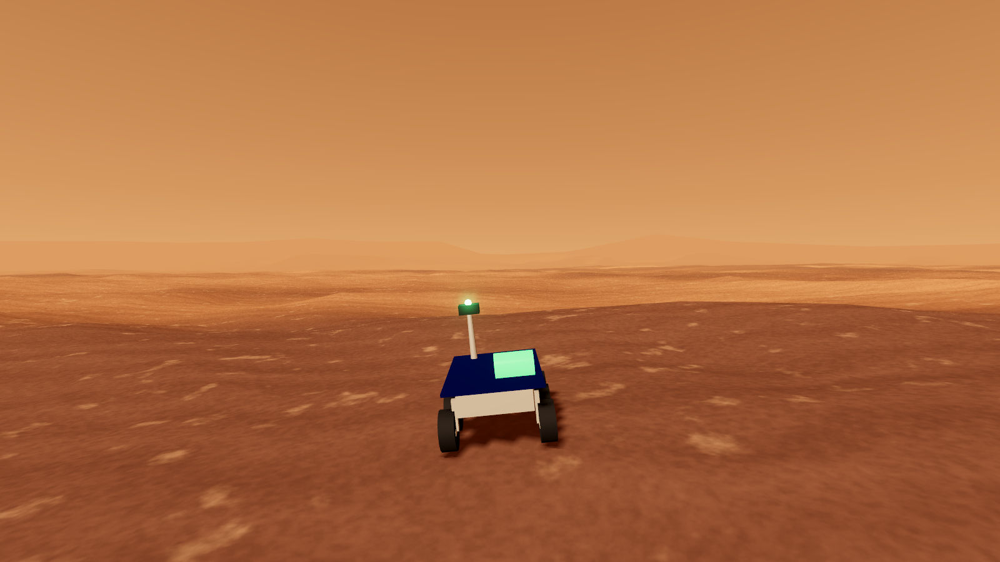
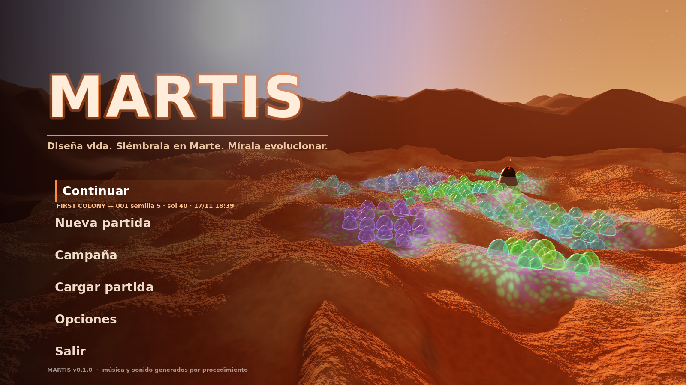
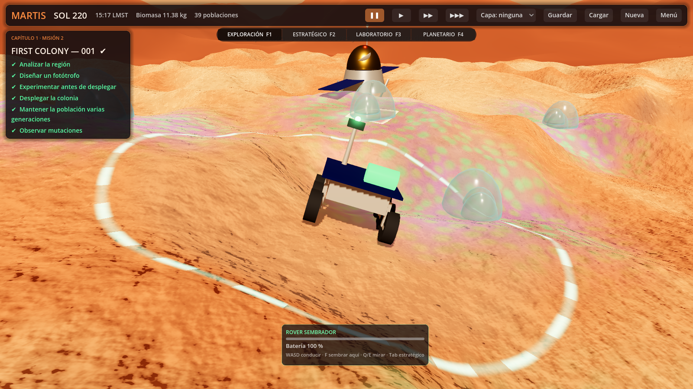
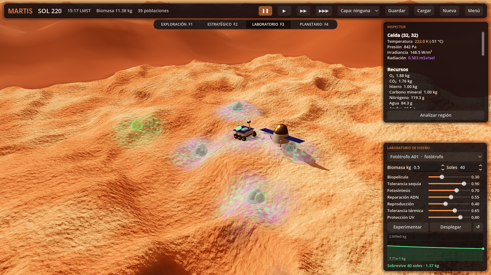
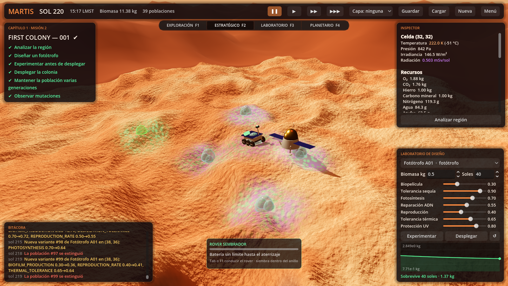
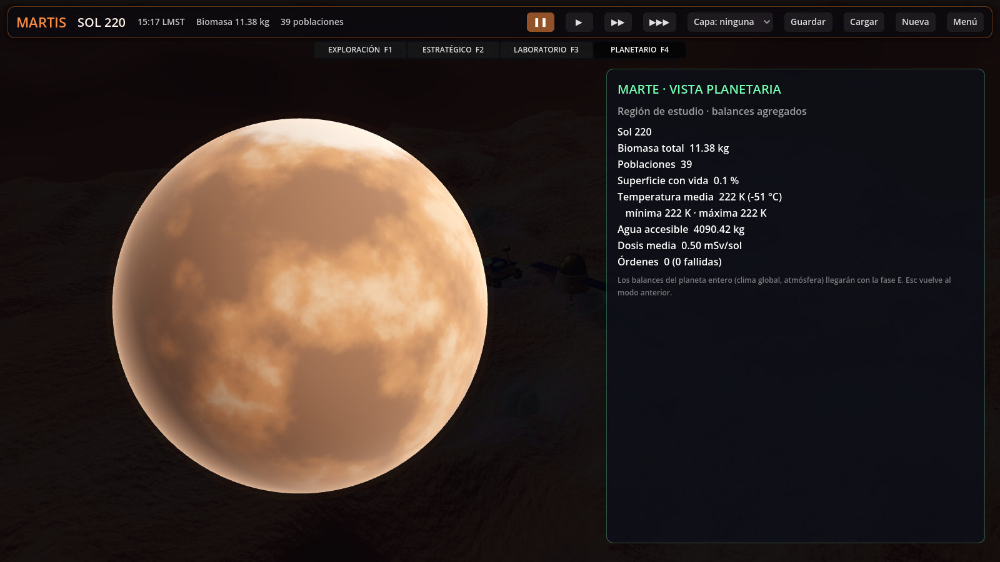
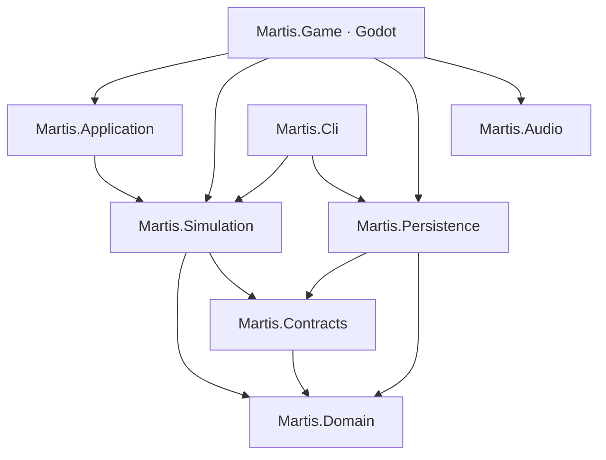

# MARTIS

MARTIS es un juego de simulación científica sobre Marte. El jugador es una IA autónoma que, con robots, siembra vida microbiana en el Marte real. Esa vida evoluciona hasta formar ecosistemas, inteligencia y civilización, y la terraformación avanza región a región.

El proyecto tiene dos partes:

- **Un motor de simulación** en C# / .NET 10, determinista y sin dependencias de Godot. Simula ambiente, metabolismo, poblaciones agregadas, evolución, ecosistemas, clima regional y guardado. Se compila y se prueba sin el editor.
- **Un juego 3D** en Godot 4.7.2 .NET (`src/Martis.Game`), con el relieve real de Marte (HRSC-MOLA y CTX), un rover en tercera persona y los modos Exploración, Estratégico, Laboratorio y Planetario sobre un único estado.



> **Documento de referencia:** el [Documento Maestro v2.0](docs/maestro/MARTIS_Documento_Maestro_v2.0.docx) (GDD + TDD) gobierna el diseño y la arquitectura desde el 2026-11-17. También está en [texto plano](docs/maestro/MARTIS_Documento_Maestro_v2.0.txt), que se puede buscar con grep. El TDD v1.0 ([docs/tdd](docs/tdd/MARTIS_TDD_v1.0.txt)) queda como antecedente: sus reglas normativas siguen vigentes donde el Documento Maestro no dice otra cosa.

**¿Vienes a colaborar?** Empieza por [CONTRIBUTING.md](CONTRIBUTING.md) y por [docs/ESTADO.md](docs/ESTADO.md), que explica qué está hecho, qué falta y por dónde seguir.

## Inicio rápido

### Requisitos

| Herramienta | Versión | Para qué |
| --- | --- | --- |
| .NET SDK | **10.0.404**, fijado en [`global.json`](global.json) (`rollForward: latestPatch`) | motor, tests, CLI y juego |
| Godot .NET | **4.7.2-stable**, la versión *mono*/.NET ([archivo de descargas](https://godotengine.org/download/archive/)) | jugar y editar escenas |
| Python 3 + `rasterio pandas pyarrow pillow` | opcional | solo para regenerar el relieve de `data/planets` |

Instalación del SDK exacto:

```bash
curl -fsSL https://dot.net/v1/dotnet-install.sh -o dotnet-install.sh
bash dotnet-install.sh --version 10.0.404     # Windows: dotnet-install.ps1 -Version 10.0.404
dotnet --version
```

### Compilar y probar el motor

```bash
dotnet restore MARTIS.sln
dotnet build MARTIS.sln -c Release      # 0 avisos
dotnet test MARTIS.sln -c Release       # unos 1.100 tests; Simulation tarda ~4 min
```

### Jugar

```bash
dotnet build src/Martis.Game/Martis.Game.csproj
godot --path src/Martis.Game            # o abre src/Martis.Game/project.godot en el editor
```

La primera vez, o después de añadir scripts nuevos, ejecuta `godot --headless --path src/Martis.Game --import` para que Godot genere los ficheros `.uid`.

### Comprobar el juego sin pantalla

```bash
godot --headless --path src/Martis.Game -- --smoke         # recorre todo el juego y termina con 0 si va bien
godot --headless --path src/Martis.Game -- --title-smoke   # pantalla de inicio
```

El smoke imprime una línea `MARTIS smoke …=True` por sistema: llegada, conocimiento, muestras, robots, calor, valle, menú Esc, rover, secciones, historia y guardado. Los dos smokes deben pasar antes de abrir un PR que toque el juego.

## Cómo se juega

La pantalla de inicio ofrece **Continuar**, **Nueva partida**, **Campaña**, **Cargar partida**, **Opciones** y **Salir**. El modo historia es una sola partida sobre un único Marte persistente. Empieza en Isidis occidental, en el lugar de aterrizaje de Perseverance, y avanza de los microbios a la civilización. Cada era abre nuevas secciones del planeta.



| Tecla | Acción |
| --- | --- |
| **Esc** | menú: modos F1–F4, guardar, cargar, nueva partida, campaña, sonido, título y salir |
| F1 / F2 / F3 / F4 | Exploración / Estratégico / Laboratorio / Planetario (Tab alterna Exploración y Estratégico) |
| WASD o flechas | conducir el rover (Exploración) o mover la cámara |
| F · C · M | sembrar · escanear · tomar muestra (Exploración) |
| B · H · X | construir estación · calefactor · reparar (Exploración) |
| G | enviar el rover al punto elegido (fuera de Exploración) |
| R | árbol de investigación |
| 0–4 | capa del mapa: ninguna, temperatura, agua, radiación, biomasa |
| Espacio | pausa |
| F5 / F9 | guardar / cargar |

Las partidas se guardan en `user://martis.db` (SQLite, el mismo formato que el CLI).

| Exploración | Laboratorio |
| --- | --- |
|  |  |
| **Estratégico** | **Planetario** |
|  |  |

### Opciones de línea de comandos del juego

Se pasan después de `--`. Todas son para pruebas y capturas; quien juega no las necesita.

| Opción | Efecto |
| --- | --- |
| `--smoke`, `--title-smoke` | pruebas automáticas, sin pantalla |
| `--shot=x.png --hour=0.7` | captura de la colonia a una hora del sol |
| `--real-shot=x.png` | captura sobre el relieve real |
| `--menu-shot=x.png`, `--title-shot=x.png --title-time=9` | capturas de los menús |
| `--mission=<id>` | empieza directamente en una misión de `data/missions` |
| `--procedural` | terreno inventado en lugar del Marte real (como antes de M1) |
| `--seed=<n>`, `--grid=<64/128/256>`, `--db=<ruta>`, `--era=<n>`, `--section=<id>` | semilla, tamaño de mapa, base de datos, era y sección de inicio |

Para hacer capturas en Linux sin GPU: `xvfb-run` y `VK_ICD_FILENAMES=/usr/share/vulkan/icd.d/lvp_icd.json` (paquete `mesa-vulkan-drivers`).

## CLI del motor

El CLI ejecuta la simulación sin juego, siguiendo el flujo del TDD §19. Sirve para experimentos reproducibles y para depurar.

```bash
dotnet run --project src/Martis.Cli -c Release -- --version
dotnet run --project src/Martis.Cli -c Release -- simulate --scenario mars_baseline --seed 12345 --ticks 1000 --output results/experiment_001
# FIRST COLONY: fotótrofo diseñado + descomponedor
dotnet run --project src/Martis.Cli -c Release -- simulate --scenario mars_baseline --seed 5 --ticks 400 --output results/first_colony \
  --introduce "phototroph_a01@32,32:0.5+UV_PROTECTION=0.85" --introduce decomposer_d01@32,32:0.05 \
  --mission first_colony --mission-action analyze-region --mission-action run-experiment
# guardar cada 50 ticks y continuar más tarde
dotnet run --project src/Martis.Cli -c Release -- simulate --scenario mars_baseline --seed 12345 --ticks 100 --output results/a --introduce phototroph_a01@32,32:0.5 --save results/partida.db --snapshot-interval 50
dotnet run --project src/Martis.Cli -c Release -- simulate --scenario mars_baseline --save results/partida.db --resume save-1 --ticks 100 --output results/b
```

Códigos de salida: **0** éxito; **1** fallo de ejecución (violación de invariante, datos ausentes o error de escritura); **2** argumentos inválidos.

En `--output` se escriben `metadata.json`, `final_snapshot.json` (JSON canónico `martis-state-v1`), `resource_history.csv`, `population_history.csv`, `mutations.csv`, `mass_balance.csv` y `simulation.log`. Con la misma semilla, plataforma y runtime, dos ejecuciones escriben los mismos bytes (VAL-010).

## Arquitectura



| Proyecto | Contenido |
| --- | --- |
| `src/Martis.Domain` | tipos del modelo: biología, genética, ambiente, mundo, validación. Solo BCL |
| `src/Martis.Contracts` | comandos (solo datos, sin `Apply`), snapshots y eventos |
| `src/Martis.Simulation` | motor de ticks y sistemas: metabolismo, poblaciones, evolución, ecología, economía, misiones, expedición, terraformación, planetas y `GameSession`, la fachada que usa el juego |
| `src/Martis.Persistence` | guardado SQLite y formato binario de snapshots |
| `src/Martis.Application` | lógica de juego sin Godot: modos, órdenes y control del tiempo |
| `src/Martis.Audio` | audio en C# puro: piano grabado (VCSL, CC0), música por estados de ánimo, efectos y masterización |
| `src/Martis.Cli` | CLI `simulate` |
| `src/Martis.Game` | juego Godot. **No está en `MARTIS.sln`**: lo compila Godot.NET.Sdk |
| `benchmarks/Martis.Benchmarks` | BenchmarkDotNet, `-- --profile N` para tiempo por paso ([docs/BENCHMARK.md](docs/BENCHMARK.md)) |
| `tests/*` | xUnit por proyecto, más `Martis.Integration.Tests` (arquitectura, CLI, extremo a extremo) |
| `data/` | datos versionados (`*.v1.json`): escenario MarsBaseline, reacciones, organismos, misiones, campaña «Génesis», economía, expedición y planetas |
| `data/planets/mars/` | relieve real por sección (PNG de 16 bits + metadatos), generado con `tools/planet/build_region.py` |
| `tools/` | `planet/build_region.py` (relieve real) y `piano-bank/build_bank.py` (banco de piano) |

### Reglas que comprueban los tests

Las comprueban las pruebas de arquitectura (`Category=Architecture`). Romperlas hace fallar la CI:

- El grafo de arriba sin ciclos. Domain no referencia nada; Contracts solo referencia Domain; Simulation no referencia Persistence, Cli, Godot ni SQLite. El CLI no referencia Contracts ni Domain directamente.
- El juego solo usa la API de `GameSession` (`GameBoundaryTests`).
- Determinismo: en `src/` no aparecen `System.Random`, `Random.Shared`, `GetHashCode()`, `Parallel.*`, `AsParallel()`, `Task.Run`, `DateTime.Now`/`UtcNow` ni `Guid.NewGuid()`. Todo el azar sale de los cinco flujos `pcg32-v1` (ADR-003).
- No hay recursos gratis: las reacciones están balanceadas por elemento y nunca se consume más de lo disponible (VAL-006/007/008).
- No hay datos científicos inventados: cada número del modelo lleva fuente o la clasificación `MODEL_ASSUMPTION`, `GAME_BALANCE` o `SPECULATIVE` (ADR-000 R5).
- Las poblaciones son agregadas, con variantes por celda; no hay individuos como objetos (ADR-006, Documento Maestro ARC-004).

Las decisiones están en [docs/ADR](docs/ADR/README.md) (ADR-000 a ADR-039).

## CI

GitHub Actions ([`.github/workflows/ci.yml`](.github/workflows/ci.yml)) en `ubuntu-latest` y `windows-latest`. Los pasos son restore en `--locked-mode` (los `packages.lock.json` no pueden cambiar), build Release, tests y, en Linux, compilación del juego con Godot.NET.Sdk. La CI no instala el editor de Godot, así que los smokes del juego se ejecutan en local.

## Documentación

| Documento | Para qué |
| --- | --- |
| [CONTRIBUTING.md](CONTRIBUTING.md) | flujo de trabajo: ramas, PRs, ADR, pruebas y convenciones |
| [docs/ESTADO.md](docs/ESTADO.md) | estado actual, pendientes conocidos y siguientes pasos |
| [docs/maestro/](docs/maestro/) | Documento Maestro v2.0 (diseño y arquitectura vigentes) |
| [docs/ADR/](docs/ADR/README.md) | registro de decisiones |
| [docs/TDD_HUECOS.md](docs/TDD_HUECOS.md) | huecos y deudas abiertas (H-nn) |
| [docs/PR_CHECKLIST.md](docs/PR_CHECKLIST.md) | lista de revisión de cada PR |
| [docs/DATA_DICTIONARY.md](docs/DATA_DICTIONARY.md), [docs/INVARIANTES.md](docs/INVARIANTES.md) | diccionario de datos e invariantes VAL-001…010 |
| [docs/BENCHMARK.md](docs/BENCHMARK.md) | rendimiento medido |
| [docs/ROADMAP.md](docs/ROADMAP.md), [docs/SPRINT_01.md](docs/SPRINT_01.md) | plan original T01–T10 y Sprint 1 (completados; histórico) |

## Licencias de recursos

Todo el audio se sintetiza en código, salvo el piano: es un Steinway B del [VCSL](https://github.com/sgossner/VCSL) (CC0). El relieve procede de HRSC-MOLA y de DTMs CTX públicos; el script de `tools/planet` indica las fuentes. El proyecto todavía no tiene licencia de código (H-23).
