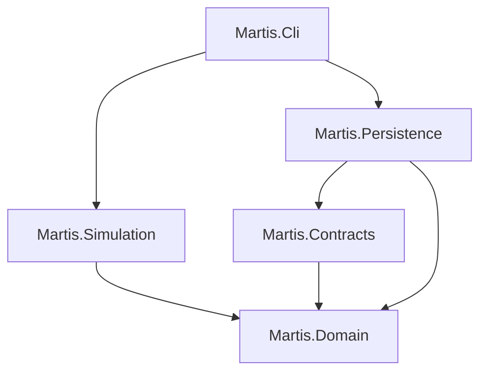

# MARTIS

Motor de simulación científica en C# / .NET. Este repositorio contiene el motor y el ejecutable sin interfaz. La aplicación Godot (`Martis.Game`) no forma parte de la solución: el motor se compila y se prueba sin Godot.

Este árbol corresponde al hito **T01 Infrastructure** del TDD v1.0 (§1.2 y §16): solución, proyectos, referencias, identificadores tipados y pruebas de arquitectura. La simulación en sí llega en hitos posteriores.

## Requisitos

- **.NET SDK 10.0.404** (LTS, runtime 10.0.15), fijado en [`global.json`](global.json).
- `rollForward`: `latestFeature` (banda 10.0; no salta a .NET 11).
- `allowPrerelease`: `false`.
- TFM de todos los proyectos: **net10.0** (`Directory.Build.props`).

El 2026-11-15, 10.0.404 es el SDK más alto publicado en el canal 10.0 ([descargas de .NET 10](https://dotnet.microsoft.com/download/dotnet/10.0), metadatos `10.0/releases.json`: `latest-sdk` = `10.0.404`). Con esa política, `latestFeature` resuelve a **10.0.404**.

Instalación del SDK exacto:

```bash
curl -fsSL https://dot.net/v1/dotnet-install.sh -o dotnet-install.sh
bash dotnet-install.sh --version 10.0.404
dotnet --version
```

En Windows, el instalador equivalente es `dotnet-install.ps1 -Version 10.0.404`.

## Compilar y probar

Desde la raíz del repositorio:

```bash
dotnet restore MARTIS.sln
dotnet build MARTIS.sln -c Release
dotnet test MARTIS.sln -c Release
```

`Martis.Integration.Tests` tiene una referencia de compilación a Simulation, Persistence y Contracts. Además obliga a compilar `Martis.Cli` (`ReferenceOutputAssembly=false`): el proyecto de tests no usa tipos del CLI, solo necesita el ensamblado ya construido en `src/Martis.Cli/bin/<Configuration>/net10.0/Martis.Cli.dll`.

Versión del motor:

```bash
dotnet run --project src/Martis.Cli -c Release -- --version
```

Salida esperada: `MARTIS 0.1.0` y código de salida 0. Cualquier otro argumento termina con código 1. `0.1.0` es la versión de producto del motor (`Version` en `Directory.Build.props`), no un dato científico.

## Grafo de dependencias

Canónico según la tabla del TDD §1.2. No se usa la arista extra del diagrama `image1.png`.

| Proyecto | Referencias |
| --- | --- |
| Martis.Domain | ninguna (solo BCL, sin paquetes) |
| Martis.Simulation | Domain |
| Martis.Contracts | Domain |
| Martis.Persistence | Domain, Contracts, paquete Microsoft.Data.Sqlite |
| Martis.Cli | Simulation, Persistence |
| Martis.Domain.Tests | Domain |
| Martis.Simulation.Tests | Simulation |
| Martis.Persistence.Tests | Persistence |
| Martis.Integration.Tests | Simulation, Persistence, Contracts |



`Martis.Game` no está en `MARTIS.sln` ni en el árbol (H-17). `benchmarks/` queda para T10.

## Estructura

```
MARTIS.sln
global.json
Directory.Build.props
Directory.Packages.props
src/Martis.Domain/          Biology/ Genetics/ Ecology/ Environment/ Common/
src/Martis.Simulation/      Engine/ Systems/ Algorithms/ Random/ Spatial/ Validation/
src/Martis.Contracts/       Commands/ Snapshots/ Events/
src/Martis.Persistence/     SQLite/ Serialization/ Migrations/
src/Martis.Cli/             Commands/ Program.cs
tests/Martis.Domain.Tests/
tests/Martis.Simulation.Tests/
tests/Martis.Persistence.Tests/
tests/Martis.Integration.Tests/
data/                       genes/ organisms/ reactions/ environments/ scenarios/
.github/workflows/ci.yml
```

Las carpetas vacías reservan el sitio de los hitos siguientes. T01 solo implementa los identificadores tipados de §2.1 y el comando `--version`.

## Versiones de paquetes

Fijadas el 2026-11-15 en [`Directory.Packages.props`](Directory.Packages.props). Central Package Management; los `.csproj` no repiten la versión. Son las últimas estables de cada id compatibles con `net10.0` (el nuspec de `Microsoft.Data.Sqlite` 11.0.0 declara TFM `net10.0`).

| Paquete | Versión |
| --- | --- |
| [xunit](https://www.nuget.org/packages/xunit/2.9.3) | 2.9.3 |
| [xunit.runner.visualstudio](https://www.nuget.org/packages/xunit.runner.visualstudio/4.0.1) | 4.0.1 |
| [Microsoft.NET.Test.Sdk](https://www.nuget.org/packages/Microsoft.NET.Test.Sdk/18.12.0) | 18.12.0 |
| [coverlet.collector](https://www.nuget.org/packages/coverlet.collector/10.1.1) | 10.1.1 |
| [Microsoft.Data.Sqlite](https://www.nuget.org/packages/Microsoft.Data.Sqlite/11.0.0) | 11.0.0 |

El id `xunit` 2.9.3 es la última versión estable de ese paquete (xUnit v2). El adaptador 4.0.1 declara compatibilidad con xUnit.net 1.9.2 y posteriores.

## Pruebas de arquitectura

En `tests/Martis.Integration.Tests`, con el rasgo `Category=Architecture`:

- Por reflexión (`Assembly.GetReferencedAssemblies`): `Martis.Domain` no referencia ensamblados `Godot*`, `Microsoft.Data.Sqlite*`, `SQLitePCL*` ni `Martis.*`. Simulation y Contracts tampoco referencian Godot ni SQLite. Simulation no referencia Persistence, Cli ni Contracts. Contracts no referencia Simulation.
- Por los `.csproj` (BCL, sin paquetes extra): el grafo de arriba, sin ciclos. La reflexión no ve una referencia de proyecto que ningún método usa; el examen del `.csproj` sí.
- El código de `src/` no llama a `System.Random`, `GetHashCode()`, `Parallel.*`, `AsParallel()`, `Task.Run`, `DateTime.Now`, `DateTime.UtcNow` ni `Guid.NewGuid()`. Los comentarios pueden nombrarlas; el escáner los quita antes de buscar.

`dotnet test` puede imprimir `VSTEST_ARTIFACTS_DIRECTORY environment variable was not found... outdated Microsoft.NET.Test.Sdk`. Sale de `testhost` 18.12.0 (el paquete fijado, que es el último estable) cuando el proceso no define esa variable. No es un aviso del compilador: `dotnet build -c Release` termina con 0 avisos. Definir la variable apunta el directorio de artefactos del host y el texto desaparece. La CI la define.

## CI

GitHub Actions (`.github/workflows/ci.yml`) en `ubuntu-latest` y `windows-latest`: `actions/setup-dotnet` lee `global.json`, luego `dotnet restore`, `dotnet build -c Release --no-restore` y `dotnet test -c Release --no-build`. No instala Godot.

## Fuera de este hito

- Lógica de simulación, estado del mundo, PRNG, escenarios y validadores VAL-001..010 (T02 en adelante).
- `Martis.Game`, escenas y el SDK de Godot (T08).
- `benchmarks/` (T10).
- Esquema SQLite, migraciones y partidas guardadas (T07). El proyecto de persistencia solo abre una base en memoria para comprobar el paquete.
- `metadata.json` con la versión del runtime y del SDK (lo pide ADR-002 para cada ejecución; no hay ejecución de escenario todavía).

## Decisiones pendientes

- **H-01.** La tabla §1.2 no incluye Simulation → Contracts, aunque `CreateSnapshot()` devolverá tipos de Contracts. ADR-000 (propuesto) añade esa arista. **T01 no la añade**: manda el brief de T01. Hace falta la decisión de Dani antes de T02/T03.
- **H-02.** `ISimulationCommand.Apply(SimulationState)` en Contracts ciclaría si `SimulationState` vive en Simulation. T01 no declara comandos ni estado. La estructura actual no obliga a ese ciclo.
- **H-17.** `Martis.Game` queda fuera de `MARTIS.sln`. La CI no depende de Godot.
- **H-27.** No hay `Martis.Contracts.Tests` ni `Martis.Cli.Tests`. El brief fija cuatro proyectos de test; Contracts y el CLI se cubren desde `Martis.Integration.Tests`.
- **ADR-002** acepta el SDK 10 y pone como ejemplo un `rollForward` solo de parches. El brief de T01 fija `latestFeature`. Se usa `latestFeature`. Hoy coincide con 10.0.404 porque no hay un SDK 10.0 más alto.
