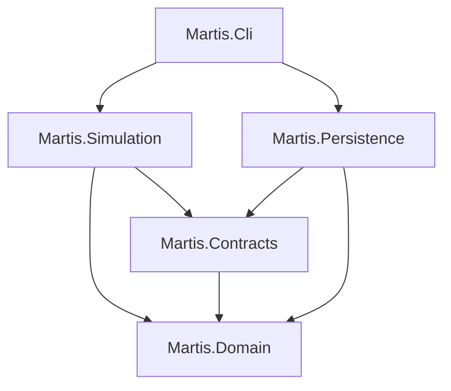

# MARTIS

Motor de simulación científica en C# / .NET. Este repositorio contiene el motor y el ejecutable sin interfaz. La aplicación Godot (`Martis.Game`) no forma parte de la solución: el motor se compila y se prueba sin Godot.

Este árbol corresponde al hito **T01 Infrastructure**, al modelo de dominio de **T02** y a la base de motor de **T03a**: cargador genérico de parámetros, configuración en soles, PRNG `pcg32-v1`, cinco flujos, motor con sistemas stub y el comando `simulate`. No hay escenario de Marte ni ficheros en `data/scenarios/*.json`.

## Requisitos

- **.NET SDK 10.0.404** (LTS, runtime 10.0.15), fijado en [`global.json`](global.json).
- `rollForward`: `latestPatch` (misma banda 10.0.4xx; no salta de feature band ni a .NET 11). Decisión del lead, alineada con ADR-002.
- `allowPrerelease`: `false`.
- TFM de todos los proyectos: **net10.0** (`Directory.Build.props`).

El 2026-11-15, 10.0.404 es el SDK más alto publicado en el canal 10.0 ([descargas de .NET 10](https://dotnet.microsoft.com/download/dotnet/10.0), metadatos `10.0/releases.json`: `latest-sdk` = `10.0.404`). Con `latestPatch` el SDK activo sigue siendo **10.0.404** mientras no exista un parche posterior de la banda 10.0.4xx.

Instalación del SDK exacto:

```bash
curl -fsSL https://dot.net/v1/dotnet-install.sh -o dotnet-install.sh
bash dotnet-install.sh --version 10.0.404
dotnet --version
```

En Windows, el instalador equivalente es `dotnet-install.ps1 -Version 10.0.404`.

## Compilar y probar

Desde la raíz del repositorio:

```bash
dotnet restore MARTIS.sln
dotnet build MARTIS.sln -c Release
dotnet test MARTIS.sln -c Release
```

`Martis.Integration.Tests` tiene una referencia de compilación a Simulation, Persistence y Contracts. Además obliga a compilar `Martis.Cli` (`ReferenceOutputAssembly=false`): el proyecto de tests no usa tipos del CLI, solo necesita el ensamblado ya construido en `src/Martis.Cli/bin/<Configuration>/net10.0/Martis.Cli.dll`.

Versión del motor:

```bash
dotnet run --project src/Martis.Cli -c Release -- --version
```

Salida esperada: `MARTIS 0.1.0` y código de salida 0. Un argumento que no sea `--version` ni un `simulate` válido termina con código 1. `0.1.0` es la versión de producto del motor (`Version` en `Directory.Build.props`), no un dato científico.

`simulate` crea un mundo vacío de 64×64, avanza los ticks con sistemas stub e imprime el tick final. Acepta `--scenario` y `--output` y no lee ni escribe ficheros.

```bash
dotnet run --project src/Martis.Cli -- simulate --scenario mars_baseline --seed 12345 --ticks 1000 --output /tmp/m2
```

## Grafo de dependencias

La tabla del TDD §1.2 más la arista **Simulation → Contracts**, aprobada por el lead (H-01). Contracts no referencia Simulation.

| Proyecto | Referencias |
| --- | --- |
| Martis.Domain | ninguna (solo BCL, sin paquetes) |
| Martis.Simulation | Domain, Contracts |
| Martis.Contracts | Domain |
| Martis.Persistence | Domain, Contracts, paquete Microsoft.Data.Sqlite |
| Martis.Cli | Simulation, Persistence |
| Martis.Domain.Tests | Domain |
| Martis.Simulation.Tests | Simulation |
| Martis.Persistence.Tests | Persistence |
| Martis.Integration.Tests | Simulation, Persistence, Contracts |



`Martis.Game` no está en `MARTIS.sln` ni en el árbol (H-17). `benchmarks/` queda para T10.

## Estructura

```
MARTIS.sln
global.json
Directory.Build.props
Directory.Packages.props
src/Martis.Domain/          Biology/ Genetics/ Ecology/ Environment/ Common/ World/ Validation/
src/Martis.Simulation/      Engine/ Systems/ Algorithms/ Random/ Spatial/ Validation/
src/Martis.Contracts/       Commands/ Snapshots/ Events/
src/Martis.Persistence/     SQLite/ Serialization/ Migrations/
src/Martis.Cli/             Commands/ Program.cs
tests/Martis.Domain.Tests/
tests/Martis.Simulation.Tests/
tests/Martis.Persistence.Tests/
tests/Martis.Integration.Tests/
data/                       genes/ organisms/ reactions/ environments/ scenarios/
.github/workflows/ci.yml
```

T02 llena Biology, Genetics, Environment, World y Validation. T03a añade `Parameters` en Domain, el PRNG y el motor en Simulation, y el comando `simulate` en el CLI. Ecology sigue vacío. El diccionario está en [`docs/DATA_DICTIONARY.md`](docs/DATA_DICTIONARY.md).

## Versiones de paquetes

Fijadas el 2026-11-15 en [`Directory.Packages.props`](Directory.Packages.props). Central Package Management; los `.csproj` no repiten la versión. `RestorePackagesWithLockFile` escribe un `packages.lock.json` junto a cada proyecto. Son las últimas estables de cada id compatibles con `net10.0` (el nuspec de `Microsoft.Data.Sqlite` 11.0.0 declara TFM `net10.0`).

| Paquete | Versión |
| --- | --- |
| [xunit](https://www.nuget.org/packages/xunit/2.9.3) | 2.9.3 |
| [xunit.runner.visualstudio](https://www.nuget.org/packages/xunit.runner.visualstudio/4.0.1) | 4.0.1 |
| [Microsoft.NET.Test.Sdk](https://www.nuget.org/packages/Microsoft.NET.Test.Sdk/18.12.0) | 18.12.0 |
| [coverlet.collector](https://www.nuget.org/packages/coverlet.collector/10.1.1) | 10.1.1 |
| [Microsoft.Data.Sqlite](https://www.nuget.org/packages/Microsoft.Data.Sqlite/11.0.0) | 11.0.0 |
| [CsCheck](https://www.nuget.org/packages/CsCheck/5.0.1) | 5.0.1 |

El id `xunit` 2.9.3 es la última versión estable de ese paquete (xUnit v2). El adaptador 4.0.1 declara compatibilidad con xUnit.net 1.9.2 y posteriores. CsCheck 5.0.1 es la última estable publicada en nuget.org el 2026-11-16 y solo la usan las pruebas de propiedades de `Martis.Simulation.Tests`. El motor no la referencia: su azar es `pcg32-v1`.

## Pruebas de arquitectura

En `tests/Martis.Integration.Tests`, con el rasgo `Category=Architecture`:

- Por reflexión (`Assembly.GetReferencedAssemblies`): `Martis.Domain` no referencia ensamblados `Godot*`, `Microsoft.Data.Sqlite*`, `SQLitePCL*` ni `Martis.*`. Simulation referencia Domain y Contracts, y no referencia Persistence, Cli, Godot ni SQLite. Contracts referencia solo Domain: nunca Simulation, Persistence, Cli, SQLite ni Godot.
- Por los `.csproj` (BCL, sin paquetes extra): el grafo de arriba, sin ciclos. La reflexión no ve una referencia de proyecto que ningún método usa; el examen del `.csproj` sí.
- El código de `src/` no llama a `System.Random`, `Random.Shared`, `GetHashCode()`, `Parallel.*`, `AsParallel()`, `Task.Run`, `DateTime.Now`, `DateTime.UtcNow` ni `Guid.NewGuid()`. En Domain y Simulation tampoco llama a `Environment.TickCount` ni a `Stopwatch`. Los comentarios pueden nombrarlas; el escáner los quita antes de buscar. El comando `simulate` no es el prototipo del TDD §19: no carga un escenario ni guarda resultados.

`dotnet test` puede imprimir `VSTEST_ARTIFACTS_DIRECTORY environment variable was not found... outdated Microsoft.NET.Test.Sdk`. Sale de `testhost` 18.12.0 (el paquete fijado, que es el último estable) cuando el proceso no define esa variable. No es un aviso del compilador: `dotnet build -c Release` termina con 0 avisos. Definir la variable apunta el directorio de artefactos del host y el texto desaparece. La CI la define.

## CI

GitHub Actions (`.github/workflows/ci.yml`) en `ubuntu-latest` y `windows-latest`: `actions/setup-dotnet` lee `global.json` y cachea NuGet (`cache: true`, clave `**/packages.lock.json`), luego `dotnet restore MARTIS.sln --locked-mode`. A continuación `git diff --exit-code -- '**/packages.lock.json'` y `git status --porcelain` sobre esos ficheros: el restore con SDK 10.0.404 puede recrear un lock que no estaba en el índice, y el paso falla si el diff no está vacío o si `status` muestra alguno. Después, `dotnet build -c Release --no-restore` y `dotnet test -c Release --no-build`. No instala Godot.

## Fuera de este hito

- El CLI `simulate` sigue creando un mundo vacío: todavía no abre el escenario (S1-32). La biblioteca sí carga MarsBaseline v0.4, con `EnvironmentSystem` a temperatura constante. VAL-004 se comprueba en `NextBool`. VAL-010 se comprueba en la misma plataforma. VAL-006..008 siguen pendientes. El trasvase de agua entre compartimentos llega en T04.
- `Martis.Game`, escenas y el SDK de Godot (T08).
- `benchmarks/` (T10).
- Esquema SQLite, migraciones y partidas guardadas (T07). El proyecto de persistencia solo abre una base en memoria para comprobar el paquete.
- `metadata.json` con la versión del runtime y del SDK (lo pide ADR-002 para cada ejecución; no hay ejecución de escenario todavía).

## Regla de Contracts

`Martis.Contracts` solo contiene datos: `ISimulationCommand` no tiene `Apply`. El handler está en `Martis.Simulation` y el motor aplica la cola al empezar el tick. Contracts referencia únicamente Domain: nunca Simulation, Persistence, Cli, SQLite ni Godot.

## Decisiones del lead en este PR

- **H-01.** Simulation referencia Contracts, además de Domain.
- **H-02.** El ciclo se evita dejando los datos en Contracts y la aplicación en Simulation. Sin tipos de comando en este hito.
- **Roll-forward.** `global.json` usa `latestPatch` con la versión 10.0.404, como indica ADR-002. En la revisión el lead lo nombra H-27.
- **H-17.** `Martis.Game` sigue fuera de `MARTIS.sln`. La CI no depende de Godot.
- Los cuatro proyectos de test del brief se mantienen. Contracts y el CLI se cubren desde `Martis.Integration.Tests`. ADR-000 lo actualiza el lead; este PR no lo modifica.
