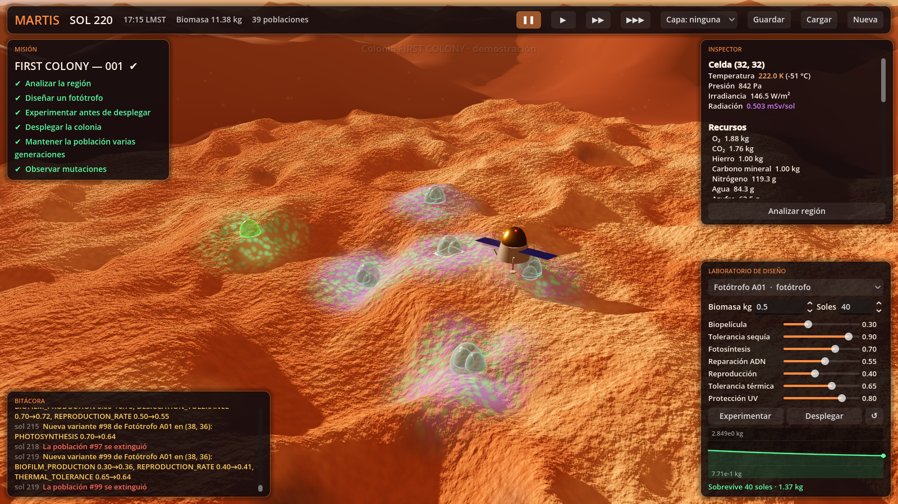
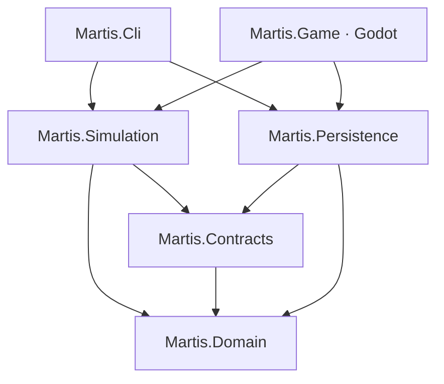
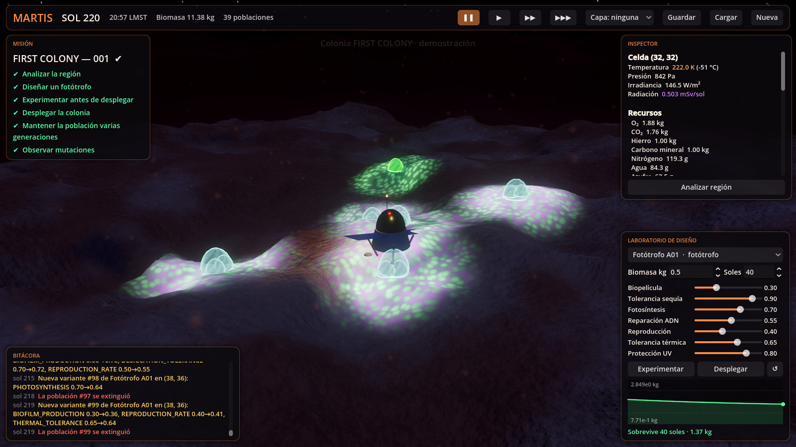
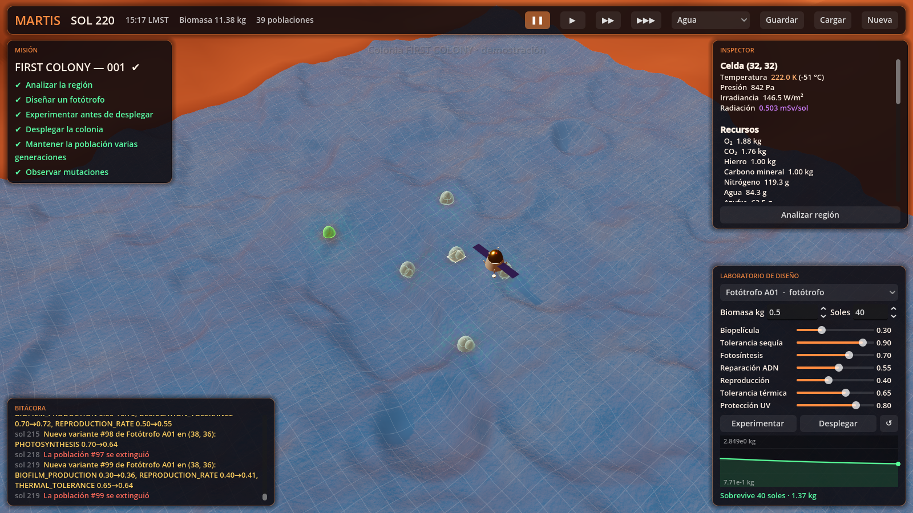

# MARTIS

Motor de simulación científica en C# / .NET y juego 3D en Godot 4.7.2 (`src/Martis.Game`). El juego no forma parte de la solución: el motor se compila y se prueba sin Godot.



Este árbol corresponde al hito **T01 Infrastructure**, al modelo de dominio de **T02**, a la base de motor de **T03a**, al escenario MarsBaseline v0.4 de **T03b** y al prototipo CLI del TDD §19 (S1-31 a S1-33): snapshot completo del estado, exportación JSON canónica y el comando `simulate` que carga el escenario, avanza los ticks, valida y guarda los resultados. **T04** añade el motor metabólico: especies y reacciones balanceadas en `data/reactions`, organismos en `data/organisms` y la opción `--introduce` para inocular poblaciones ([ADR-012](docs/ADR/ADR-012-modelo-metabolico.md)). **T05** añade mortalidad, inanición, capacidad de carga, extinción y reciclaje ([ADR-013](docs/ADR/ADR-013-dinamica-de-poblaciones.md)). **T06** añade mutación, deriva, fusión de variantes y `mutations.csv` ([ADR-014](docs/ADR/ADR-014-evolucion.md)). **T07** añade el guardado en SQLite con `--save`, `--snapshot-interval` y `--resume` ([ADR-015](docs/ADR/ADR-015-guardado-sqlite.md)). **T09** añade el descomponedor y el extremófilo, el diseño de genomas y la misión FIRST COLONY ([ADR-016](docs/ADR/ADR-016-ecosistema-y-first-colony.md)).

## Requisitos

- **.NET SDK 10.0.404** (LTS, runtime 10.0.15), fijado en [`global.json`](global.json).
- `rollForward`: `latestPatch` (misma banda 10.0.4xx; no salta de feature band ni a .NET 11). Decisión del lead, alineada con ADR-002.
- `allowPrerelease`: `false`.
- TFM de todos los proyectos: **net10.0** (`Directory.Build.props`).

El 2026-11-15, 10.0.404 es el SDK más alto publicado en el canal 10.0 ([descargas de .NET 10](https://dotnet.microsoft.com/download/dotnet/10.0), metadatos `10.0/releases.json`: `latest-sdk` = `10.0.404`). Con `latestPatch` el SDK activo sigue siendo **10.0.404** mientras no exista un parche posterior de la banda 10.0.4xx.

Instalación del SDK exacto:

```bash
curl -fsSL https://dot.net/v1/dotnet-install.sh -o dotnet-install.sh
bash dotnet-install.sh --version 10.0.404
dotnet --version
```

En Windows, el instalador equivalente es `dotnet-install.ps1 -Version 10.0.404`.

## Compilar y probar

Desde la raíz del repositorio:

```bash
dotnet restore MARTIS.sln
dotnet build MARTIS.sln -c Release
dotnet test MARTIS.sln -c Release
```

`Martis.Integration.Tests` tiene una referencia de compilación a Simulation, Persistence y Contracts. Además obliga a compilar `Martis.Cli` (`ReferenceOutputAssembly=false`): el proyecto de tests no usa tipos del CLI, solo necesita el ensamblado ya construido en `src/Martis.Cli/bin/<Configuration>/net10.0/Martis.Cli.dll`.

Versión del motor:

```bash
dotnet run --project src/Martis.Cli -c Release -- --version
```

Salida esperada: `MARTIS 0.1.0` y código de salida 0. Un argumento que no sea `--version` ni un `simulate` válido termina con código 2. `0.1.0` es la versión de producto del motor (`Version` en `Directory.Build.props`), no un dato científico.

`simulate` ejecuta el flujo del TDD §19: carga `mars_baseline` desde `data/scenarios/MarsBaseline`, crea el mundo de 64×64, inicializa el ambiente y los cinco flujos `pcg32-v1`, avanza `--ticks` con la validación activada, toma el snapshot completo y escribe los resultados en `--output`. Imprime el tick final.

```bash
dotnet run --project src/Martis.Cli -c Release -- simulate --scenario mars_baseline --seed 12345 --ticks 1000 --output results/experiment_001
# con biología (pipeline-v3): 0,5 kg del fotótrofo A01 en la celda (32, 32)
dotnet run --project src/Martis.Cli -c Release -- simulate --scenario mars_baseline --seed 12345 --ticks 300 --output results/experiment_002 --introduce phototroph_a01@32,32:0.5
# FIRST COLONY: fotótrofo diseñado + descomponedor; se completa en el tick 200 (mission.json)
dotnet run --project src/Martis.Cli -c Release -- simulate --scenario mars_baseline --seed 5 --ticks 400 --output results/first_colony --introduce "phototroph_a01@32,32:0.5+UV_PROTECTION=0.85" --introduce decomposer_d01@32,32:0.05 --mission first_colony --mission-action analyze-region --mission-action run-experiment
# guardar cada 50 ticks y continuar más tarde (el id se imprime en stderr: «Save id: save-1»)
dotnet run --project src/Martis.Cli -c Release -- simulate --scenario mars_baseline --seed 12345 --ticks 100 --output results/a --introduce phototroph_a01@32,32:0.5 --save results/partida.db --snapshot-interval 50
dotnet run --project src/Martis.Cli -c Release -- simulate --scenario mars_baseline --save results/partida.db --resume save-1 --ticks 100 --output results/b
```

Opciones extra: `--root <dir>` apunta a la raíz del repositorio si el comando no se lanza desde dentro de él (por defecto busca `data/scenarios/MarsBaseline` subiendo desde el directorio actual y desde el ejecutable). `--history-interval <n>` fija cada cuántos ticks se escribe una fila de historial (por defecto 30, la frecuencia orientativa de TDD §8.1; es un valor de ingeniería, no del modelo).

Códigos de salida: **0** éxito; **1** fallo de ejecución (violación de invariante, datos del escenario ausentes o error de escritura); **2** argumentos inválidos (convención de `docs/SPRINT_01.md`).

Ficheros de `--output` (H-16):

| Fichero | Contenido |
| --- | --- |
| `metadata.json` | estado, semilla (texto, para no perder bits de `ulong`), ticks, escenario y versión de datos, versión del motor, del pipeline, del esquema de snapshot y del PRNG, runtime, SDK de compilación, RID y SHA-256 del snapshot |
| `final_snapshot.json` | `StateSnapshot` completo en JSON canónico (`martis-state-v1`): configuración, tick, estado de los cinco flujos, todas las celdas y todas las poblaciones con su genoma |
| `resource_history.csv` | totales de los nueve depósitos y del hielo (kg) en el tick 0, cada `--history-interval` ticks y en el último |
| `population_history.csv` | número de poblaciones, abundancia y biomasa totales en los mismos ticks (todo 0 hasta T05) |
| `simulation.log` | escenario, semilla, pipeline, avisos del cargador y resultado; ante un fallo, una línea por violación con VAL-id, semilla, tick, celda (índice y x, y), población, paso y valor |

Ninguna salida lleva hora, ruta ni nombre de máquina: dos ejecuciones con la misma semilla en la misma plataforma y runtime escriben los mismos bytes (VAL-010, TDD §6). Si una validación falla, el CLI escribe igualmente los cinco ficheros; el snapshot es el último tick confirmado y `metadata.json` dice `"status": "failed"`. `mutations.csv` y `mass_balance.csv` llegan con T06 y T04.

El JSON de `final_snapshot.json` es exportación y depuración (ADR-004). El formato binario de guardado en SQLite llega en T07.

## Grafo de dependencias

La tabla del TDD §1.2 más la arista **Simulation → Contracts**, aprobada por el lead (H-01). Contracts no referencia Simulation.

| Proyecto | Referencias |
| --- | --- |
| Martis.Domain | ninguna (solo BCL, sin paquetes) |
| Martis.Simulation | Domain, Contracts |
| Martis.Contracts | Domain |
| Martis.Persistence | Domain, Contracts, paquete Microsoft.Data.Sqlite |
| Martis.Cli | Simulation, Persistence |
| Martis.Domain.Tests | Domain |
| Martis.Simulation.Tests | Simulation |
| Martis.Persistence.Tests | Persistence |
| Martis.Integration.Tests | Simulation, Persistence, Contracts |



`Martis.Game` (juego 3D, T08) está en `src/Martis.Game` pero no en `MARTIS.sln` (H-17). `benchmarks/` queda para T10.

## Estructura

```
MARTIS.sln
global.json
Directory.Build.props
Directory.Packages.props
src/Martis.Domain/          Biology/ Genetics/ Ecology/ Environment/ Common/ World/ Validation/
src/Martis.Simulation/      Engine/ Systems/ Algorithms/ Random/ Spatial/ Validation/
src/Martis.Contracts/       Commands/ Snapshots/ Events/
src/Martis.Persistence/     SQLite/ Serialization/ Migrations/
src/Martis.Cli/             Commands/ Program.cs
tests/Martis.Domain.Tests/
tests/Martis.Simulation.Tests/
tests/Martis.Persistence.Tests/
tests/Martis.Integration.Tests/
data/                       genes/ organisms/ reactions/ environments/ scenarios/
.github/workflows/ci.yml
```

T02 llena Biology, Genetics, Environment, World y Validation. T03a añade `Parameters` en Domain, el PRNG y el motor en Simulation, y el comando `simulate` en el CLI. Ecology sigue vacío. El diccionario está en [`docs/DATA_DICTIONARY.md`](docs/DATA_DICTIONARY.md).

## Versiones de paquetes

Fijadas el 2026-11-15 en [`Directory.Packages.props`](Directory.Packages.props). Central Package Management; los `.csproj` no repiten la versión. `RestorePackagesWithLockFile` escribe un `packages.lock.json` junto a cada proyecto. Son las últimas estables de cada id compatibles con `net10.0` (el nuspec de `Microsoft.Data.Sqlite` 11.0.0 declara TFM `net10.0`).

| Paquete | Versión |
| --- | --- |
| [xunit](https://www.nuget.org/packages/xunit/2.9.3) | 2.9.3 |
| [xunit.runner.visualstudio](https://www.nuget.org/packages/xunit.runner.visualstudio/4.0.1) | 4.0.1 |
| [Microsoft.NET.Test.Sdk](https://www.nuget.org/packages/Microsoft.NET.Test.Sdk/18.12.0) | 18.12.0 |
| [coverlet.collector](https://www.nuget.org/packages/coverlet.collector/10.1.1) | 10.1.1 |
| [Microsoft.Data.Sqlite](https://www.nuget.org/packages/Microsoft.Data.Sqlite/11.0.0) | 11.0.0 |
| [CsCheck](https://www.nuget.org/packages/CsCheck/5.0.1) | 5.0.1 |

El id `xunit` 2.9.3 es la última versión estable de ese paquete (xUnit v2). El adaptador 4.0.1 declara compatibilidad con xUnit.net 1.9.2 y posteriores. CsCheck 5.0.1 es la última estable publicada en nuget.org el 2026-11-16 y solo la usan las pruebas de propiedades de `Martis.Simulation.Tests`. El motor no la referencia: su azar es `pcg32-v1`.

## Pruebas de arquitectura

En `tests/Martis.Integration.Tests`, con el rasgo `Category=Architecture`:

- Por reflexión (`Assembly.GetReferencedAssemblies`): `Martis.Domain` no referencia ensamblados `Godot*`, `Microsoft.Data.Sqlite*`, `SQLitePCL*` ni `Martis.*`. Simulation referencia Domain y Contracts, y no referencia Persistence, Cli, Godot ni SQLite. Contracts referencia solo Domain: nunca Simulation, Persistence, Cli, SQLite ni Godot.
- Por los `.csproj` (BCL, sin paquetes extra): el grafo de arriba, sin ciclos. La reflexión no ve una referencia de proyecto que ningún método usa; el examen del `.csproj` sí.
- El código de `src/` no llama a `System.Random`, `Random.Shared`, `GetHashCode()`, `Parallel.*`, `AsParallel()`, `Task.Run`, `DateTime.Now`, `DateTime.UtcNow` ni `Guid.NewGuid()`. En Domain y Simulation tampoco llama a `Environment.TickCount` ni a `Stopwatch`. Los comentarios pueden nombrarlas; el escáner los quita antes de buscar.

`dotnet test` puede imprimir `VSTEST_ARTIFACTS_DIRECTORY environment variable was not found... outdated Microsoft.NET.Test.Sdk`. Sale de `testhost` 18.12.0 (el paquete fijado, que es el último estable) cuando el proceso no define esa variable. No es un aviso del compilador: `dotnet build -c Release` termina con 0 avisos. Definir la variable apunta el directorio de artefactos del host y el texto desaparece. La CI la define.

## CI

GitHub Actions (`.github/workflows/ci.yml`) en `ubuntu-latest` y `windows-latest`: `actions/setup-dotnet` lee `global.json` y cachea NuGet (`cache: true`, clave `**/packages.lock.json`), luego `dotnet restore MARTIS.sln --locked-mode`. A continuación `git diff --exit-code -- '**/packages.lock.json'` y `git status --porcelain` sobre esos ficheros: el restore con SDK 10.0.404 puede recrear un lock que no estaba en el índice, y el paso falla si el diff no está vacío o si `status` muestra alguno. Después, `dotnet build -c Release --no-restore` y `dotnet test -c Release --no-build`. En Linux compila además el juego con `dotnet build src/Martis.Game/Martis.Game.csproj` (Godot.NET.Sdk llega por NuGet). No instala el editor de Godot.

## Juego (T08)

Requisitos: [Godot 4.7.2-stable .NET](https://godotengine.org/download/archive/) y el SDK de .NET 10. Detalle en [ADR-017](docs/ADR/ADR-017-juego-3d-godot.md).

```bash
dotnet build src/Martis.Game/Martis.Game.csproj
godot --path src/Martis.Game                       # jugar
godot --headless --path src/Martis.Game -- --smoke # 30 soles, guardar, cargar; sale con 0
godot --path src/Martis.Game -- --shot=captura.png --hour=0.7   # demostración y captura
```

Controles: botón derecho gira la cámara, rueda acerca, botón central o WASD desplaza, Q/E giran. Espacio pausa, 0–4 cambian la capa (temperatura, agua, radiación, biomasa), F5 guarda, F9 carga. Clic izquierdo inspecciona una celda; con «Desplegar» activo, inocula el diseño del laboratorio. Las partidas se guardan en `user://martis.db` con el mismo formato que el CLI.

| Noche | Capa de agua |
| --- | --- |
|  |  |

## Fuera de este hito

- `EnvironmentSystem` mantiene la temperatura constante (sin ciclos diurno ni estacional). VAL-004 se comprueba en `NextBool`. VAL-010 se comprueba en la misma plataforma. VAL-006..008 siguen pendientes. El trasvase de agua entre compartimentos llega en T04.
- `benchmarks/` (T10).
- Esquema SQLite, migraciones y partidas guardadas (T07). El proyecto de persistencia solo abre una base en memoria para comprobar el paquete.
- Matriz de invariantes VAL-001..010 (S1-34) y benchmark inicial (S1-35).

## Regla de Contracts

`Martis.Contracts` solo contiene datos: `ISimulationCommand` no tiene `Apply`. El handler está en `Martis.Simulation` y el motor aplica la cola al empezar el tick. Contracts referencia únicamente Domain: nunca Simulation, Persistence, Cli, SQLite ni Godot.

## Decisiones del lead en este PR

- **H-01.** Simulation referencia Contracts, además de Domain.
- **H-02.** El ciclo se evita dejando los datos en Contracts y la aplicación en Simulation. Sin tipos de comando en este hito.
- **Roll-forward.** `global.json` usa `latestPatch` con la versión 10.0.404, como indica ADR-002. En la revisión el lead lo nombra H-27.
- **H-17.** `Martis.Game` sigue fuera de `MARTIS.sln`. La CI no depende del editor de Godot; desde T08 compila el juego con Godot.NET.Sdk.
- Los cuatro proyectos de test del brief se mantienen. Contracts y el CLI se cubren desde `Martis.Integration.Tests`. ADR-000 lo actualiza el lead; este PR no lo modifica.
