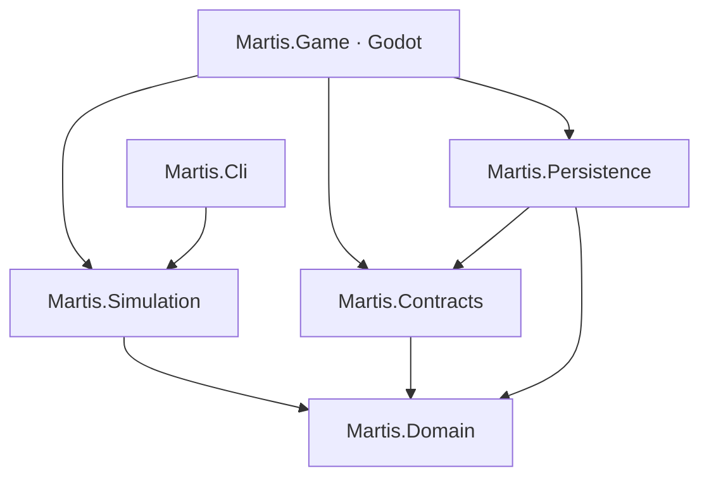

# ADR-000 — Reglas de arquitectura de MARTIS

- **Estado:** Propuesto. El TDD v1.0 (§0, §1.2–1.3, §3.1, §6, §21) ya lo da por cerrado; queda pendiente el visto bueno de Dani para fijarlo como ADR aceptado.
- **Fuente:** `docs/MARTIS_TDD_v1.0.txt` (ARC-001, ARC-006, ARC-007, ARC-008, §1.2, §6, §10, §21).
- **Fecha:** 2026-11-16

## Contexto

MARTIS tiene dos productos: *MARTIS Simulation* (motor científico) y *MARTIS Game* (aplicación Godot). El motor debe poder ejecutarse, probarse y validarse sin Godot, sin interfaz y sin dispositivo de render (TDD §0). Estas reglas son las invariantes de arquitectura que todo PR debe respetar; los ADR-001..010 las concretan decisión a decisión.

## Reglas

### R1. Pureza del dominio
`Martis.Domain` **no importa Godot ni SQLite** (ni `Microsoft.Data.Sqlite`, ni componentes de presentación). Propuesta adicional: `Martis.Domain` no tiene `PackageReference` alguno; solo BCL.

### R2. Sin referencias circulares (grafo de §1.2)
Aristas permitidas (A → B = «A referencia a B»):

| Proyecto | Puede referenciar |
|---|---|
| Martis.Domain | (nada) |
| Martis.Simulation | Domain |
| Martis.Contracts | Domain |
| Martis.Persistence | Domain, Contracts |
| Martis.Game | Simulation, Contracts, Persistence |
| Martis.Cli | Simulation, Persistence |
| *.Tests / Benchmarks | el proyecto probado |

Reglas derivadas: el motor no conoce escenas, nodos ni controles de Godot (§1.3); Godot nunca accede a estructuras mutables internas, solo a comandos, snapshots inmutables y eventos (§8).

> **Discrepancia pendiente (H-01 en `TDD_HUECOS.md`)**: el diagrama `image1.png` dibuja además la arista *Simulation → Contracts* (necesaria para que `ISimulationEngine.CreateSnapshot()` devuelva tipos de Contracts), y no dibuja *Cli → Persistence*, que sí aparece en la tabla de §1.2. Este ADR toma como canónica la tabla de §1.2 **más** *Simulation → Contracts* hasta que Dani confirme. Cualquier cambio de aristas requiere un ADR nuevo.

### R3. Nunca recursos gratis (ARC-007, §3.1, §10, §21)
- Ninguna cantidad física es negativa; el consumo nunca supera lo disponible; la biomasa no aparece sin fuente de materia; la energía no se crea.
- Toda reacción se balancea por elemento (A·S = 0) y se comprueba el balance de masa `ε_M ≤ ε_abs + ε_rel·|M_esperada|` (§10.1).
- Los recursos compartidos se reparten mediante buffers de asignación por celda; ninguna población resta directamente de un depósito compartido ni obtiene ventaja por orden de iteración (§5.4, §12.3).
- La capacidad de carga `K` limita el crecimiento, nunca crea recursos (§3.5).
- Se cumplen los invariantes VAL-001..VAL-010 (§10).

### R4. Determinismo y reproducibilidad (ARC-005, ARC-006, §6)
- Misma semilla + configuración + orden de comandos + versión de motor ⇒ mismo resultado.
- PRNG propio: **PCG32** con versión de algoritmo fijada (ADR-003). Prohibido `System.Random` en la simulación.
- **Flujos RNG independientes**: Environment, Mutation, Reproduction, Genetic Drift y Events. Añadir una llamada aleatoria en un sistema no debe desplazar las secuencias de los demás.
- Prohibido `GetHashCode()` como semilla o para ordenar/derivar nada; prohibido iterar `Dictionary`/`HashSet` sin orden explícito cuando el resultado afecta al estado.
- Prohibido paralelismo no determinista (ADR-007): sin `Parallel.*`, PLINQ ni `Task.Run` dentro de la simulación hasta demostrar que no altera resultados.
- Sin `DateTime.Now`, `Guid.NewGuid()` ni dependencias del entorno/cultura en el estado de simulación; formato numérico con cultura invariante.
- Estado del PRNG, versión de motor, versión de datos y algoritmo PRNG se guardan en snapshots y metadatos.
- Límite conocido (§6): el determinismo entre ejecuciones **no** garantiza idéntico resultado entre arquitecturas ni versiones del runtime. La reproducibilidad se declara por misma plataforma/versión.

### R5. Datos y parámetros etiquetados (ARC-008, §10.2)
Todo parámetro de modelo vive en datos externos (JSON) con `id`, `value`, `unit`, `classification` (`SCIENTIFIC_MEASURED`, `SCIENTIFIC_ESTIMATED`, `MODEL_ASSUMPTION`, `GAME_BALANCE`, `SPECULATIVE`), `source` y `version`. Sin dato científico inventado: un valor sin fuente nunca se clasifica como `SCIENTIFIC_*`. Una media planetaria no sustituye una medición regional (§10.3).

### R6. Poblaciones agregadas (ARC-003, §21)
No hay individuos como objetos de simulación; solo poblaciones agregadas con variantes genéticas diferenciadas.

## Consecuencias

- Los PR se revisan con `docs/PR_CHECKLIST.md`, que operacionaliza estas reglas.
- Se necesitan tests de arquitectura automáticos (S1-05) en vez de depender de revisión visual.
- Algunas reglas añaden fricción (por ejemplo, ordenar siempre las colecciones) a cambio de reproducibilidad.

## Cómo se verifica

- Test de arquitectura que lee los `.csproj` y falla ante una arista no permitida o un ciclo; test que falla si `Martis.Domain` referencia paquetes o namespaces `Godot*`/`*Sqlite*`.
- Búsqueda automática (CI) de `System.Random`, `GetHashCode`, `Parallel.`, `AsParallel`, `Task.Run`, `DateTime.Now`, `Guid.NewGuid` en `src/Martis.Domain` y `src/Martis.Simulation`.
- Tests de reproducibilidad (VAL-010) y de invariantes (VAL-001..009) en cada hito.
- Auditoría de parámetros: ningún JSON de `data/` sin `classification`; todo `SCIENTIFIC_*` con `source`.

## Enmienda 2026-11-16 (H-01, H-02), decisión del lead
- Se permite la dependencia **Martis.Simulation → Martis.Contracts**.
- **Martis.Contracts** contiene solo datos (comandos como records sin lógica, snapshots y eventos) y depende únicamente de Martis.Domain.
- La aplicación de comandos sobre `SimulationState` (handlers) vive en **Martis.Simulation**. Así no hay ciclo Contracts ↔ Simulation.
- El test de arquitectura verifica esta arista y la ausencia de ciclos.
