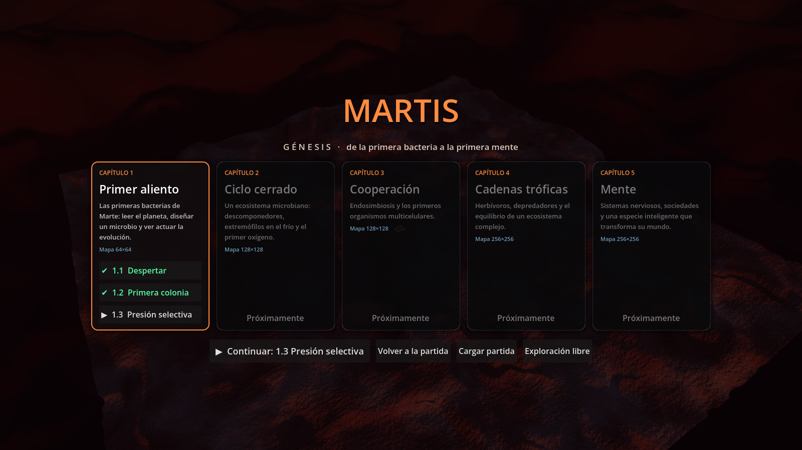
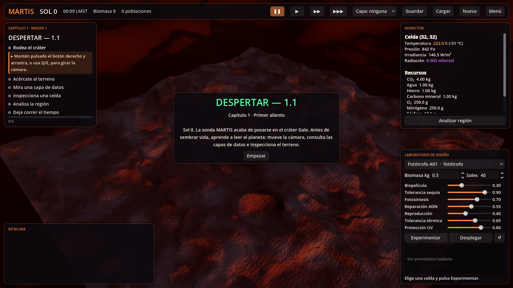

# ADR-019 — Modo historia: campaña «Génesis» (H1)

- **Estado:** Propuesto, 2026-11-16. Estructura y tamaños de mapa aprobados por Dani el mismo día. Los umbrales de las misiones están pendientes (H-32).
- **Fuente:** petición de Dani del 2026-11-16: «un modo historia para que el jugador pueda seguir paso a paso las misiones y vaya aprendiendo desde lo más básico hasta lo más complejo, desde las bacterias más básicas hasta las formas de vida más complejas e inteligentes». Amplía [ADR-016](ADR-016-ecosistema-y-first-colony.md) y [ADR-017](ADR-017-juego-3d-godot.md).

## Decisiones

### Campaña por capítulos (`data/campaign/genesis.v1.json`)

| Cap. | Título | Mapa | Enseña | Mecánica nueva | Hito |
| --- | --- | --- | --- | --- | --- |
| 1 | Primer aliento | 64×64 | cámara, capas, inspector, laboratorio, despliegue, mutación | tutorial secuencial | H1 |
| 2 | Ciclo cerrado | 128×128 | reciclado de nutrientes, nichos fríos e irradiados, O₂ | escenario con gradientes (H-30) | H3 |
| 3 | Cooperación | 128×128 | endosimbiosis, multicelularidad | transiciones evolutivas (umbral de rasgo → nueva categoría) | H4 |
| 4 | Cadenas tróficas | 256×256 | herbívoros, depredadores, equilibrio | interacción consumidor-recurso, dispersión activa | H5 |
| 5 | Mente | 256×256 | sistema nervioso, socialidad, inteligencia | rasgos de cognición y un índice de inteligencia emergente | H6 |

Las misiones se juegan en orden: una misión se desbloquea cuando está completa la anterior (`CampaignProgress`). Un capítulo sin misiones se anuncia en el menú como «Próximamente». El mapa crece con el capítulo (Dani, 2026-11-16). H2 hará el tamaño de rejilla configurable por escenario, con presupuesto de poblaciones (H-29) y terreno 3D por bloques.

### Capítulo 1

| Misión | Archivo | Objetivos |
| --- | --- | --- |
| 1.1 Despertar | `awakening.v1.json` | tutorial secuencial: girar la cámara, zoom, capa de datos, inspeccionar, analizar y dejar correr 5 soles |
| 1.2 Primera colonia | `first_colony.v1.json` | FIRST COLONY sin cambios en los objetivos (ADR-016), ahora con texto de presentación y pistas |
| 1.3 Presión selectiva | `selection.v1.json` | secuencial: desplegar un fotótrofo, ver 3 mutaciones, tener 3 genomas fotótrofos vivos a la vez y mantener ≥ 0,1 kg durante 100 soles |

### Formato de misión (compatible con v1)

- `metadata.briefing`: texto de presentación que se muestra antes de jugar.
- `metadata.sequential`: si vale `true`, solo puede cumplirse el primer objetivo pendiente. Una acción que el jugador ya hizo cuenta en cuanto llega su turno. En una misión secuencial, la racha de `sustain` solo cuenta mientras el objetivo está activo.
- `objective.hint`: la pista que el HUD muestra bajo el objetivo activo.
- Tipos nuevos: `elapsed` (soles que pasan mientras el objetivo está activo) y `diversity` (genomas distintos vivos de una capacidad, a la vez).
- Acciones del anfitrión nuevas: `orbit-camera`, `zoom-camera`, `select-overlay` e `inspect-cell`.

### Progreso guardado (cierra H-31)

`MissionTracker.Export()` produce un `MissionProgress` (objetivos cumplidos con su tick, acciones, ids de mutantes, racha, mutaciones y soles de cada `elapsed`). El juego lo guarda como un evento `mission-progress` de la partida (`SimulationEvent`), con el archivo de la misión, en el mismo tick que la instantánea. Al cargar se usa el evento de ese tick; sin él, la partida carga como antes. Ir por eventos evita una migración de esquema. Una partida guardada a mitad de FIRST COLONY termina en el mismo sol que una jugada sin cortes (test).

El progreso de la campaña (misiones completadas) vive aparte, en `user://campaign.json`.

## Consecuencias

- Los umbrales de 1.1 y 1.3 son `GAME_BALANCE` con estado `PROPOSED` (H-32).
- La pantalla de inicio de otro hilo puede abrir la campaña desde el autoload `/root/GameLaunch` (propiedades `Mode` y `ChapterId`). `GameRoot.ChapterId` y el evento `ChapterChanged` permiten que la música cambie según el capítulo.
- Las mecánicas de los capítulos 3 a 5 (transiciones evolutivas, interacción trófica y cognición) quedan fuera del alcance del MVP del TDD (§0, B.5). Cada una tendrá su propio ADR antes de implementarse, y se modelará sobre poblaciones agregadas, no sobre individuos.

