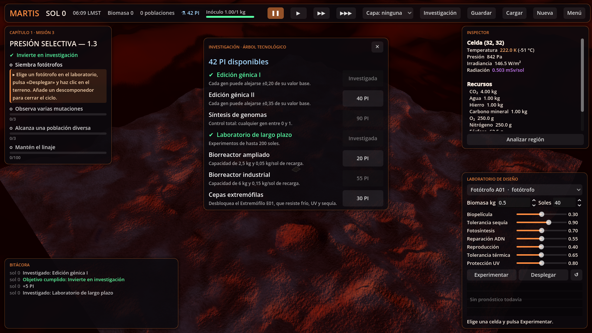

# ADR-020 — Economía del modo historia: investigación y carga del módulo (H2)

- **Estado:** Propuesto, 2026-11-16. Daniel eligió el modelo «Investigación + carga del módulo» ese mismo día. Los valores están pendientes de ajuste (H-33).
- **Fuente:** Daniel, 2026-11-16: «habría que añadir también un sistema de economía». Amplía [ADR-019](ADR-019-modo-historia.md).

## Decisiones

### Dos recursos ligados a la simulación (`data/economy/economy.v1.json`)

| Recurso | Ámbito | Se gana | Se gasta |
| --- | --- | --- | --- |
| Puntos de investigación (PI) | toda la campaña (`campaign.json`) | 5 por objetivo, 15 por misión completada y 1 por mutación observada, con un máximo de 20 por misión | árbol tecnológico |
| Inóculo (kg) | una misión (se guarda con la partida) | el biorreactor de la sonda lo recarga cada sol hasta llenarse | cada despliegue gasta la biomasa que inocula |

El laboratorio sigue siendo gratis. El tope de puntos por mutaciones existe para que esperar sin hacer nada no sea la mejor estrategia.

### Árbol tecnológico

| Tecnología | Coste | Requiere | Efecto |
| --- | --- | --- | --- |
| Edición génica I | 15 | — | genes a ±0,20 del valor base (al empezar, ±0,10) |
| Edición génica II | 40 | I | ±0,35 |
| Síntesis de genomas | 90 | II | cualquier valor entre 0 y 1 |
| Laboratorio de largo plazo | 10 | — | experimentos de hasta 200 soles (al empezar, 40) |
| Biorreactor ampliado | 20 | — | capacidad de 2,5 kg y recarga de 0,05 kg/sol (al empezar, 1 kg y 0,02 kg/sol) |
| Biorreactor industrial | 55 | ampliado | capacidad de 6 kg y recarga de 0,15 kg/sol |
| Cepas extremófilas | 30 | Edición génica I | desbloquea el Extremófilo E01 |

Los límites que rigen en cada momento son los mejores entre los valores iniciales y las tecnologías investigadas. Un requisito siempre nombra una tecnología que aparece antes en la lista, así que el árbol no puede tener ciclos. Al empezar solo están disponibles el fotótrofo A01 y el descomponedor D01, que bastan para cerrar el ciclo de FIRST COLONY.

### Motor

- `ResearchState` guarda los puntos y las tecnologías investigadas. `TryResearch` comprueba coste y requisitos, y su JSON viaja dentro de `CampaignProgress`.
- `GameSession.AttachEconomy` activa la economía en una partida de campaña; la exploración libre no tiene límites. Con la economía activa, `Introduce` comprueba el organismo, el rango de cada gen y el inóculo, y `Experiment` comprueba los soles. Cada tick recarga el biorreactor, y `ReportMission` paga los PI.
- `ResearchTechnology` también cuenta como la acción `research-technology`. Es el primer objetivo de la misión 1.3, «Invierte en investigación».
- El inóculo y los PI ya pagados por mutaciones se guardan en el evento `mission-progress` (`MissionSaveRecord.Economy`).

### Juego

En la barra superior se ven los PI, la barra de inóculo y el botón «Investigación» (tecla R), que abre el panel del árbol. El laboratorio solo permite lo investigado: los organismos bloqueados aparecen con candado, los deslizadores tienen el rango limitado, y los soles de experimento y los kg de despliegue tienen su máximo.

## Consecuencias

- Todos los números son `GAME_BALANCE` y `PROPOSED` (H-33). El primer ajuste habría que hacerlo jugando el capítulo 1.
- Los capítulos 2 a 5 añadirán tecnologías al mismo archivo (gradientes, multicelularidad, etc.).
