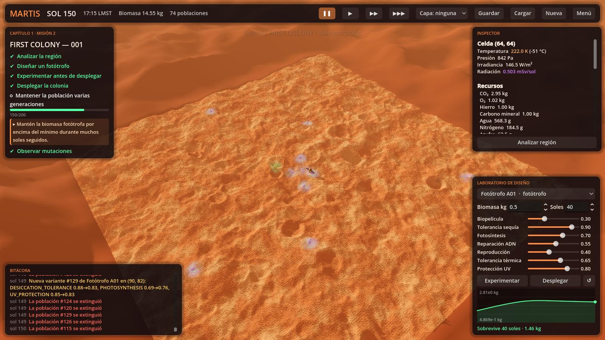
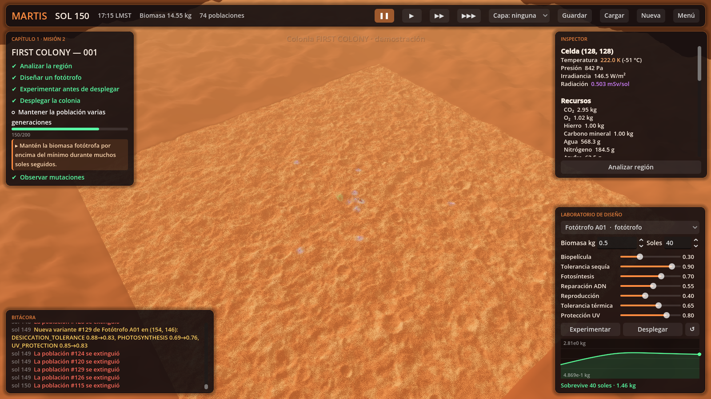

# ADR-021 — Mapas grandes: 64, 128 y 256 casillas (H3)

- **Estado:** Propuesto, 2026-11-16. Daniel eligió el tamaño creciente «64, 128 y 256» ese mismo día.
- **Fuente:** Daniel, 2026-11-16: «el escenario con ese número de casillas se nos queda bastante corto». Amplía [ADR-019](ADR-019-modo-historia.md).

## Decisiones

### Tamaño por capítulo

| Capítulo | Mapa | Presupuesto de poblaciones |
| --- | --- | --- |
| 1 Primer aliento | 64×64 | sin presupuesto (como hasta ahora) |
| 2 Ciclo cerrado, 3 Cooperación | 128×128 | 20 000 (`campaign.population_budget.grid_128`) |
| 4 Cadenas tróficas, 5 Mente | 256×256 | 30 000 (`campaign.population_budget.grid_256`) |

`GameSession` recibe un `WorldOptions(GridSize, PopulationBudget)`. Al reanudar, el tamaño sale de la instantánea; el presupuesto, del capítulo. La exploración libre deja elegir 64, 128 o 256 en el menú.

### Presupuesto de poblaciones (H-29, parcial)

Cuando hay tantas poblaciones como el presupuesto, una mutación no funda variante nueva. Las tiradas del generador aleatorio son las mismas con o sin presupuesto, así que una partida que no lo alcanza es idéntica bit a bit. Es un ajuste del anfitrión, como el tamaño del mapa, y no se guarda en la instantánea.

### Rendimiento

El coste por tick crecía con el número de casillas, no con las poblaciones. Se quitaron las copias por casilla (`ResourcePool.ValueAt`, búfer reutilizado para los totales de elementos) y el validador comprueba primero sin construir listas con nombres.

| Mapa | Antes | Después |
| --- | --- | --- |
| 64×64 | — | 8,1 ms/tick |
| 128×128 | — | 22,7 ms/tick |
| 256×256 | 148 ms/tick | 74 ms/tick |

A 256 cabe en ▶▶▶ (8 soles/s, 125 ms por sol). Quedan la copia del punto de control por tick y la validación del entorno (H-34).

### Terreno 3D por bloques

El terreno se parte en bloques de 128×128 vértices, con 4 vértices por casilla hasta 128 casillas y 2 en 256. Los cráteres crecen con el área, y la cámara, el alcance del rayo y la falda del horizonte se escalan con el mapa. El mundo se reconstruye cuando la misión cambia de tamaño.

