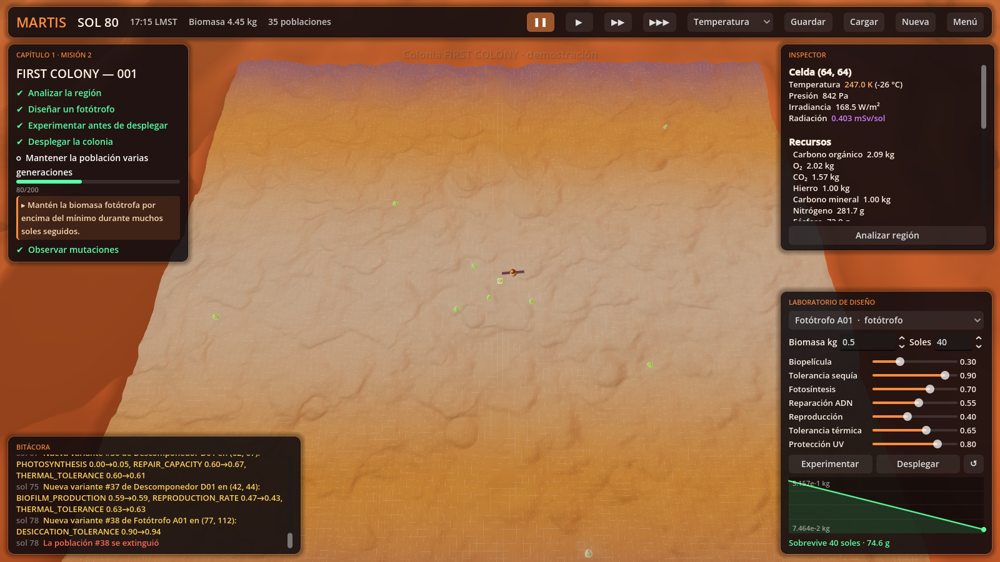

# ADR-022 — Capítulo 2 «Ciclo cerrado»: gradientes y nuevos objetivos (H4)

- **Estado:** Propuesto, 2026-11-16. Los valores son GAME_BALANCE y están pendientes de revisión con Ciencia (H-30) y de ajuste jugando (H-33).
- **Fuente:** el plan del modo historia ([ADR-019](ADR-019-modo-historia.md)) y los mapas grandes ([ADR-021](ADR-021-mapas-grandes.md)).

## Decisiones

### Gradientes sobre MarsBaseline (`data/scenarios/gradients.v1.json`)

Los capítulos 2 a 5 superponen un gradiente al escenario uniforme. El capítulo 1 sigue siendo uniforme.

| Eje | Efecto | Valores |
| --- | --- | --- |
| Latitud (fila del mapa) | temperatura | +25 K en la fila central, −30 K en los bordes norte y sur |
| Latitud | irradiancia | ×1,15 en el centro, ×0,55 en los bordes |
| Relieve (columna) | dosis ionizante | ×0,8 en las cuencas, ×1,6 en las mesetas (2 crestas a lo ancho) |

El perfil es cuadrático en la latitud. El gradiente no mueve masa, así que los libros de masa de cada casilla siguen siendo válidos. Se aplica solo al crear el mundo: al reanudar, el entorno sale de la instantánea.

### Lo que enseña la simulación

Con los parámetros actuales, en la franja cálida el fotótrofo crece tan deprisa que se bebe el agua de su casilla y muere, salvo que haya bastantes descomponedores (0,3 kg en lugar de 0,05) para devolverla. En el frío pasa lo mismo con el extremófilo, porque allí el descomponedor apenas trabaja; un extremófilo con la fotosíntesis rebajada a 0,3 sí sobrevive. El capítulo 2 se construye sobre esa lección: cerrar el ciclo del agua.

### Nuevos tipos de objetivo

| Tipo | Mide | Campos |
| --- | --- | --- |
| `occupy` | casillas distintas con poblaciones vivas | `capability` u `organism`, `min_temperature` y `max_temperature` opcionales, `count` |
| `recycle` | biomasa muerta reciclada desde que empezó la misión (kg) | `amount` |
| `accumulate` | ganancia de un recurso en todo el mapa desde que empezó la misión (kg) | `resource` (nombre de la reserva, p. ej. `Oxygen`), `amount` |

`sustain` acepta ahora también `organism` y la franja de temperatura. El progreso guardado incluye la biomasa reciclada y los totales iniciales (`Recycled`, `Baselines`).

### Misiones

| Misión | Objetivos |
| --- | --- |
| 2.1 Gradientes (guiada) | leer la capa de temperatura, fotótrofos en 3 casillas, mantener 1,5 kg durante 60 soles |
| 2.2 Ciclo cerrado | una colonia en la franja cálida (≥ 240 K), reciclar 10 kg, mantener 1 kg en la franja cálida durante 60 soles |
| 2.3 Frontera helada | extremófilos en la franja polar (≤ 205 K) y mantener 1,5 kg allí durante 60 soles |
| 2.4 Atmósfera | fotótrofos en 5 casillas, liberar 8 kg de O₂ y mantener 5 kg durante 60 soles |

Cada misión tiene un test que la completa con la investigación que se tiene al terminar el capítulo 1.

La capa de temperatura del juego pasa a cubrir 185–255 K para que se vea el gradiente.

