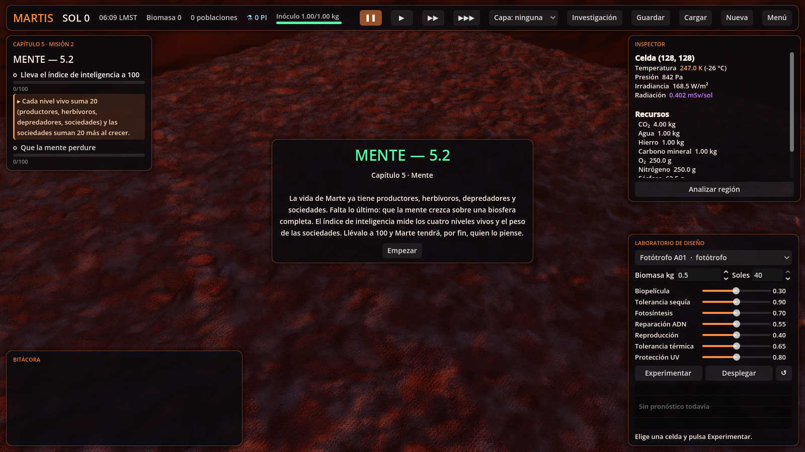

# ADR-025 — Capítulo 5 «Mente»: socialidad e índice de inteligencia (H7)

- **Estado:** Propuesto, 2026-11-17. Los valores son GAME_BALANCE y están pendientes de revisión con Ciencia.
- **Fuente:** el plan del modo historia ([ADR-019](ADR-019-modo-historia.md)).

## Decisiones

### Colonia social S01 (`data/organisms/organisms.v1.json`)

Organismo sintético hipotético con heterotrofía, respiración aerobia, depredación y **cognición**. Sus parámetros salen del Depredador P01, con la mitad de mortalidad base y más tasa de mutación (0,05). No se vende en el biorreactor: solo aparece por evolución.

### Transición «Socialidad» (`data/organisms/transitions.v1.json`)

| Socio | Condición | Biomasa mínima | Probabilidad | Fracción fundadora |
| --- | --- | --- | --- | --- |
| Depredador P01 | Reparación ADN ≥ 0,85 | 0,03 kg | 3 % por sol | 0,3 |

El depredador base tiene 0,7 de reparación, así que nunca da el salto solo. El jugador tiene que editarlo (la edición genética 1 permite ±0,2) y soltarlo donde haya herbívoros. Usa el mismo mecanismo que [ADR-023](ADR-023-capitulo-3.md): el flujo Events del RNG y conservación de masa.

### Caza cooperativa (`data/organisms/trophic.v1.json`)

| Relación | Presas | i (1/sol) | K (kg) | Eficiencia | Refugio |
| --- | --- | --- | --- | --- | --- |
| Caza | herbívoro, fotótrofo, eucariota, multicelular | 0,10 | 0,3 | 0,30 | 0,3 kg |

Funciona igual que las relaciones de [ADR-024](ADR-024-capitulo-4.md). Las sociedades son omnívoras y no cazan depredadores. Cuando solo cazaban herbívoros (y depredadores), vaciaban su casilla, morían de hambre cada 120 soles y se llevaban por delante a los depredadores, con lo que el índice caía a 80.

### Índice de inteligencia (`IntelligenceIndex`, objetivo `intelligence`)

Un número de 0 a 100 que el HUD muestra como barra de progreso:

- 20 puntos por cada nivel vivo: productores (`photoautotrophy`), herbívoros (`grazing`), depredadores (`predation`) y mentes (`cognition`).
- Hasta 20 puntos más por la biomasa de cognición, que llegan completos con la biomasa de referencia del objetivo (0,1 kg).

Una sociedad sin la cadena trófica debajo puntúa poco: esa es la lección del capítulo. El objetivo rechaza una meta por encima de 100 o una referencia que no sea positiva. `GameSession.Intelligence` da el índice cuando la misión lo mide, y null en otro caso.

### Misiones (256×256)

| Misión | Objetivos |
| --- | --- |
| 5.1 Sociedad | diseñar un depredador, que aparezca una colonia social y mantener 0,05 kg durante 60 soles |
| 5.2 Mente | índice de inteligencia 100 y mantener 0,1 kg de cognición durante 100 soles |

Cada misión tiene un test que la completa con la investigación del capítulo 4. Otro test comprueba que los depredadores sin editar nunca se vuelven sociales.

### Fuera de alcance

La especie que transforma su mundo (herramientas, construcción, terraformación) queda para después de H8. Necesita acciones de los organismos sobre el entorno que el motor todavía no modela.

