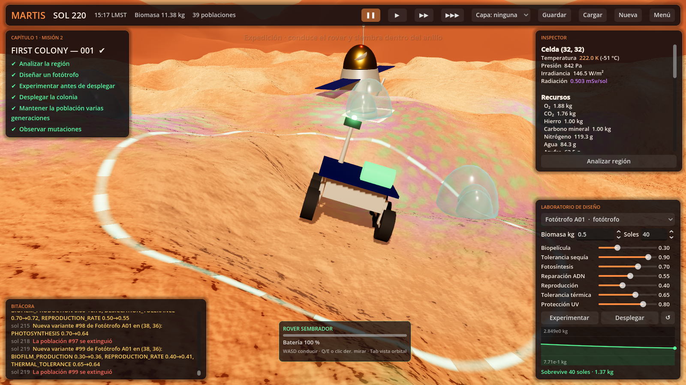

# ADR-026 — «Expedición»: el rover sembrador (J1)

- **Estado:** Propuesto, 2026-11-17. Los valores son GAME_BALANCE y están pendientes de ajuste jugando.
- **Contexto:** Daniel quiere una jugabilidad más abierta y dinámica, inspirada en los juegos de evolución con mundo abierto pero con mecánicas propias. Eligió la dirección «Expedición» el 2026-11-17, que tiene cinco hitos: J1 rover y cámara, J2 un Marte persistente con biomas, J3 eventos en tiempo real, J4 muestreo genético y editor visual, J5 criaturas visibles y balance. Este ADR cubre J1.

## Decisiones

### El jugador conduce un rover

Hasta ahora el jugador miraba el mapa desde arriba y sembraba con un clic en cualquier casilla. Con J1 hay un rover sembrador sobre el relieve 3D:

- **Tab** cambia entre la vista orbital de siempre y una cámara de persecución detrás del rover. En la vista de persecución, **WASD** (o las flechas) conducen; Q/E o el clic derecho miran alrededor, y la cámara vuelve sola detrás del rover.
- **Solo se siembra dentro del alcance** del rover (3 casillas). Un anillo discontinuo sobre el terreno marca el alcance cuando se conduce o se está en modo despliegue. Un clic fuera del anillo explica la distancia y cómo acercarse.
- **Batería.** Antes del aterrizaje el rover se mueve sin límite. Después, gasta batería por distancia (160 casillas con la carga llena), se recarga aparcado a menos de 4 casillas del módulo y, si se agota, avanza a un 30 % de velocidad en vez de quedarse atascado.

### Parámetros (`data/expedition/rover.v1.json`)

| Parámetro | Valor | Unidad |
| --- | --- | --- |
| `rover.speed` | 6 | casillas/s |
| `rover.reverse_factor` | 0,5 | 1 |
| `rover.turn` | 2,2 | rad/s |
| `rover.reach` | 3 | casillas |
| `rover.battery` | 160 | casillas |
| `rover.crawl_factor` | 0,3 | 1 |
| `rover.charge_radius` | 4 | casillas |
| `rover.charge_rate` | 0,25 | 1/s |

Los tiempos son **segundos reales de juego**, no soles: el rover forma parte de los controles, no del mundo simulado.

### El rover no entra en la simulación

`Martis.Simulation.Expedition.Rover` es un modelo puro (con tests) que solo decide qué clics se convierten en órdenes `Introduce` de `GameSession`. No toca el estado del motor, no usa el RNG y no se guarda: al cargar una partida, el rover aparece junto al módulo. Así la simulación sigue siendo determinista y las partidas guardadas no cambian de formato. Las acciones `rover-view`, `orbital-view` y `drive-rover` quedan registradas como acciones del tutorial por si la narrativa (H8) quiere usarlas.

## Consecuencias

- Ninguna misión cambia de objetivos. Sembrar ahora exige acercarse, así que las misiones de los capítulos 4 y 5 en 256×256 piden más desplazamiento: hay que revisarlo en el balance (H8).
- Las capturas de demostración aceptan `--rover` (por ejemplo, `--shot=x.png --rover --hour=0.62`) y el smoke comprueba que el rover carga sus datos, se mueve y limita el alcance.
- **Pendiente para los siguientes hitos:** el inóculo que se gasta por distancia (se cambió por la batería, que es más legible), el muestreo de mutantes salvajes (J4) y los puntos de interés que el rover descubre (J2).
