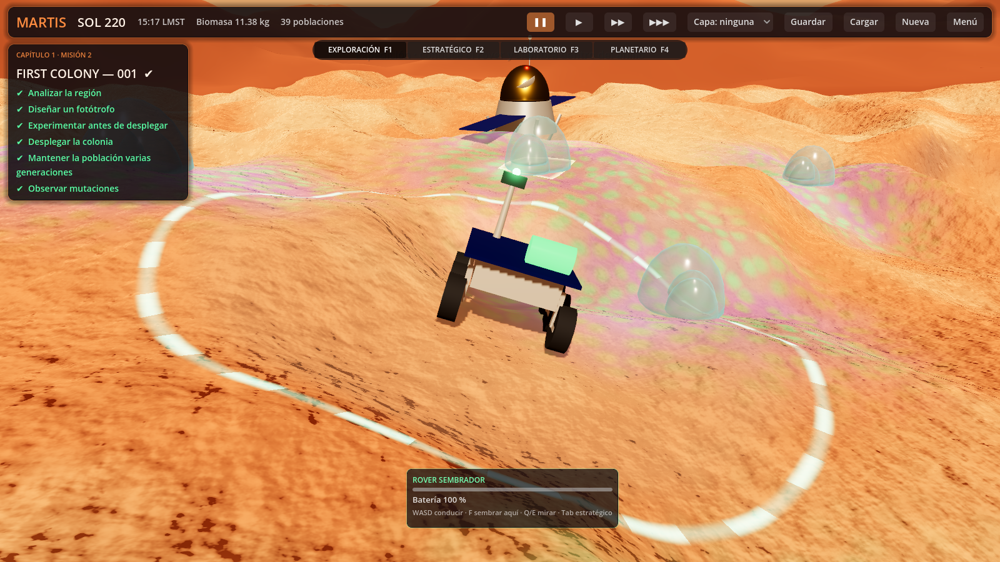
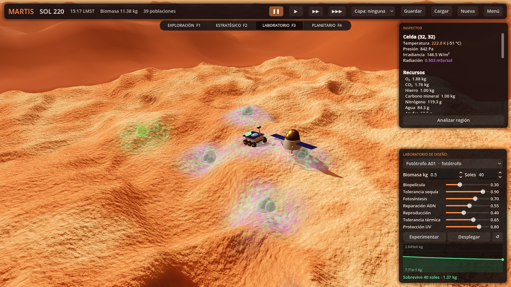
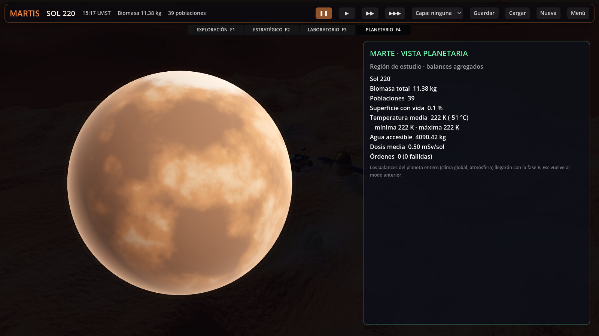

# ADR-027 — Modos de juego sobre un mismo estado (V1)

- **Estado:** Propuesto, 2026-11-17.
- **Contexto:** El 2026-11-17 Daniel adoptó el *Documento Maestro v2.0* como guía de desarrollo y descartó la reescritura continua (C) y los hitos J2–J5. El documento (§3.1) pide que los modos de juego sean presentaciones de un único estado persistente: cambiar de modo nunca congela ni duplica la simulación. También pide (§7.2) que las acciones del jugador sean órdenes con objetivo, prioridad, coste, tick de emisión, estado y resultado registrado. V1 es el primer hito del corte vertical (§32): V1 modos, V2 conocimiento y escaneo, V3 muestras y laboratorio, V4 robots e instalaciones, V5 valle y FIRST COLONY completo.

## Decisiones

### Nueva capa `Martis.Application`

Entre el motor (`Martis.Simulation`) y el juego Godot hay ahora una capa de aplicación sin dependencias de motor gráfico, probada con 17 pruebas en `Martis.Application.Tests`:

- **`ModeController`**: cuatro modos (`Exploration`, `Strategic`, `Laboratory`, `Planetary`). Empieza en Estratégico. `Switch` devuelve el cambio o `null` si no hay cambio; `Toggle` alterna Exploración ↔ Estratégico; `Back` vuelve al modo anterior desde Laboratorio o Planetario.
- **`TimeController`**: pausa y tres velocidades (2 s, 0,5 s y 0,125 s reales por sol). Cada modo puede limitar la velocidad: en Exploración el tope es ×1, así el jugador no ve pasar soles mientras conduce. El tope no cambia la velocidad pedida; al volver a Estratégico se recupera. `Advance` nunca entrega más de un tick por fotograma.
- **`OrderBook`**: cada siembra es una orden (`Order`) con tipo, objetivo, actor (`rover` o `estación`), prioridad, tick de emisión, coste estimado, estado (`Pending`, `Done`, `Failed`) y resultado. No se puede resolver dos veces ni antes de emitirse. Las órdenes resueltas aparecen en el registro.

`Martis.Game` referencia `Martis.Application`; `ProjectGraphTests` recoge las nuevas aristas.

### Los cuatro modos en el juego

Barra superior con **F1–F4** (y Tab para alternar Exploración ↔ Estratégico, Esc para volver):

| Modo | Cámara | Paneles |
| --- | --- | --- |
| Exploración | persecución del rover, WASD; **F** siembra donde está el rover | misión y batería |
| Estratégico | orbital, centrada en el rover | todos |
| Laboratorio | orbital, centrada en la celda elegida | inspector y laboratorio de diseño |
| Planetario | globo de Marte con el sitio marcado | balances agregados de la región |

La vista planetaria muestra sol, biomasa, poblaciones, superficie con vida, temperaturas, agua y dosis de la región de estudio, más las órdenes. Los balances del planeta entero llegan con la fase E.

El smoke test recorre los cuatro modos y comprueba que el tick no cambia y que una siembra deja exactamente una orden.

## Consecuencias

- La rejilla científica sigue igual (ARC-004); los modos solo cambian la presentación.
- Las órdenes se resuelven aún en el mismo fotograma. V4 añade retraso, energía y fallo por desgaste de los robots.
- Las acciones de tutorial `rover-view`, `orbital-view`, `laboratory-view`, `planetary-view` y `seed-from-rover` quedan disponibles para la campaña.
