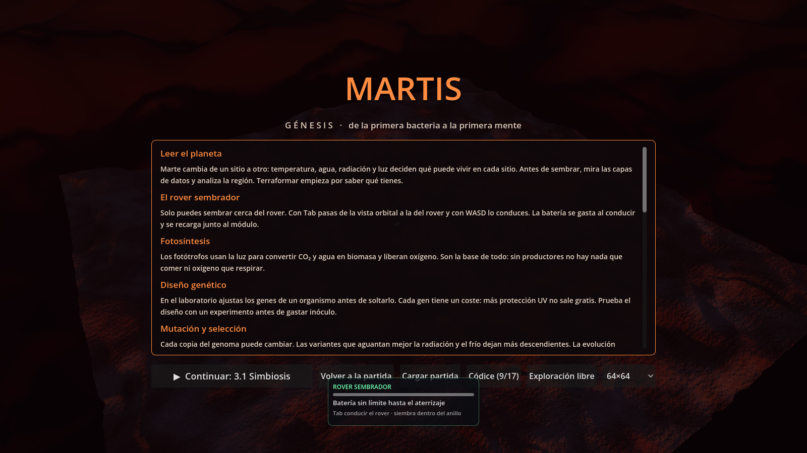

# ADR-028 — Guía progresiva, códice y eras de la campaña (H8)

- **Estado:** Propuesto, 2026-11-17. Los umbrales son GAME_BALANCE.
- **Fuente:** petición de Daniel del 2026-11-17 («ir guiando al jugador durante la campaña para que vaya aprendiendo los conceptos y a ser autónomo») y el documento maestro v2.0 (§2, §5, §11, §30, §32 y §36).
- **Base:** va sobre los modos de juego de V1 ([ADR-027](ADR-027-modos-sobre-un-estado.md)).

## Decisiones

### La ayuda se retira por capítulos (`GuidanceLevel`, `MissionGuidance`)

| Capítulo | Nivel | Qué ve el jugador |
| --- | --- | --- |
| 1 | Tutorial | Pasos en orden y la pista siempre visible |
| 2 | Pistas | La pista siempre visible y los objetivos en cualquier orden |
| 3 | A petición | Botón «Pista»; la pista también aparece sola tras 30 soles sin avanzar |
| 4 | Mínima | Sin botón; la pista aparece sola tras 90 soles sin avanzar |
| 5 | Ninguna | Sin pistas |

- **Avance:** cuenta como avance completar un objetivo o que se mueva una barra de progreso. Cualquier avance pone a cero el contador de soles. Un objetivo nuevo esconde la pista que se había pedido.
- **Umbrales:** son parámetros de `genesis.v1.json` (`campaign.guidance.*`).
- **Independencia del mundo:** la política solo mira el estado de la misión y los soles, no las casillas. Sirve igual con el mundo del documento maestro.

### Códice y resumen de misión

- **Conceptos:** `genesis.v1.json` define 17 conceptos y cada misión enseña los suyos (`teaches`). Un concepto lo enseña una sola misión.
- **Briefing:** dice qué se va a aprender y cuánta ayuda hay.
- **Al terminar:** el juego muestra el texto de cierre de la misión (`debrief`) y los conceptos nuevos.
- **Códice:** `CampaignProgress.Learned` reúne lo aprendido y el menú de campaña lo enseña en «Códice». Los conceptos que faltan aparecen bloqueados.
- **Etiqueta epistémica:** cada concepto lleva `science`, `model` o `speculative` (§2 «rigor transparente» y §36.1, que pide etiquetar lo especulativo). Socialidad e inteligencia son especulativas. Ningún concepto de la Era I lo es.

### Eras y tipos de misión del documento maestro

- **Eras (§5):** los capítulos 1 y 2 son la Era I (Génesis), el 3 y el 4 la Era II (Ecosistemas) y el 5 la Era III (Inteligencia, fuera del MVP según el documento).
- **Tipos de misión (§11):** cada misión lleva uno. Hay reconocimiento (1.1 y 2.1), colonización (1.2, que es la misión de referencia del vertical slice del §32), experimento, restauración (ciclo cerrado y red trófica) y terraformación (2.4, oxígeno). El briefing muestra la era, el capítulo, el tipo y el nivel de ayuda.

### El capítulo 1 enseña el rover

La misión 1.1 añade cinco pasos con las acciones de J1 ([ADR-026](ADR-026-expedicion-rover.md)) y V1 ([ADR-027](ADR-027-modos-sobre-un-estado.md)): modo Exploración (F1 o Tab), conducir el rover (WASD), modo Estratégico (F2), Laboratorio (F3) y Planetario (F4). La pista de despliegue de 1.2 enseña a sembrar con F donde está el rover. Las acciones `scan-site` y `collect-sample` de V2 y V3 podrán entrar en la guía cuando existan.

## Fuera de alcance

- **Herramientas de diagnóstico de fallos de misión (§30).** Explicar una extinción o un colapso necesita datos de la simulación que la guía no tiene. Se puede añadir después como pista contextual.
- **El epílogo de terraformación.** Queda pendiente del diseño de la terraformación regional del documento maestro (fase E).

