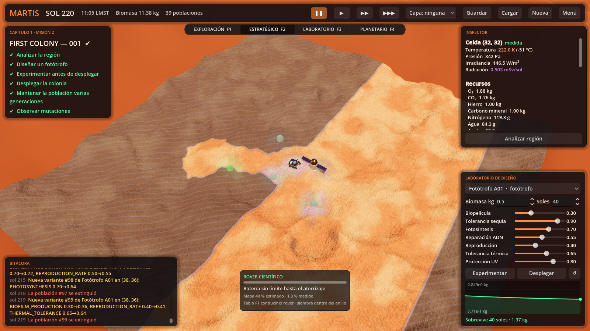

# ADR-029 — Conocimiento del terreno: sonda orbital y escáner (V2)

- **Estado:** Propuesto, 2026-11-17. Los valores son GAME_BALANCE y están pendientes de ajuste jugando.
- **Contexto:** El Documento Maestro v2.0 pide descubrimiento científico (§2): el jugador no conoce el mundo al empezar y debe medir, muestrear y actualizar modelos. El flujo de misión (§13.2) va de la observación orbital a un modelo con incertidumbre y de ahí a las sondas de superficie. V2 es el segundo hito del corte vertical (§32), tras los modos de V1 ([ADR-027](ADR-027-modos-sobre-un-estado.md)). El ADR-028 lo usa la guía de campaña H8.

## Decisiones

### Niebla de conocimiento

`Martis.Simulation.Expedition.KnowledgeMap` guarda una confianza de 0 a 1 por celda científica. Las observaciones solo la suben, nunca la bajan. Hay tres niveles:

| Nivel | Confianza | Qué ve el jugador |
| --- | --- | --- |
| Sin datos | < 0,30 | terreno velado; el inspector no da valores |
| Estimada | 0,30–0,75 | valores con «≈» y su incertidumbre (± 8 K, ± 15 % de presión, ± 30 % de dosis, ± 50 % de recursos); solo el número de poblaciones |
| Medida | ≥ 0,75 | valores exactos, genomas y biomasa |

### Fuentes de conocimiento

- **Sonda orbital.** Cada 2 soles cartografía una franja vertical de 8 celdas, empezando por la franja central, con confianza 0,45 (estimada). Un mapa de 64 queda estimado en 16 soles; uno de 256, en 64. La bitácora anota cada pasada.
- **Cámaras de navegación del rover.** Estiman un radio de 2 celdas en cada celda nueva por la que pasa.
- **Escáner del rover (tecla C en Exploración).** Mide un radio de 4 celdas con confianza 0,95, que baja un 25 % hacia el borde. Gasta un 4 % de batería tras el aterrizaje. Es una orden del libro de órdenes, con actor `rover`, y falla si falta batería. Un anillo azul se expande sobre el terreno.

### Consecuencias en el juego

- **No se siembra a ciegas.** Una colonia necesita al menos una estimación de la celda. Si no la hay, la orden falla con un aviso que explica cómo conseguirla. El botón «Analizar región» sigue la misma regla.
- **Capas.** Las capas de datos (temperatura, agua, radiación, biomasa) solo se pintan donde hay conocimiento.
- **Indicadores.** El medidor del rover y la vista planetaria muestran el porcentaje estimado y medido de la región.
- **Tutorial.** Nueva acción `scan-site` para la campaña.

### Parámetros (`data/expedition/survey.v1.json`)

| Parámetro | Valor | Unidad |
| --- | --- | --- |
| `survey.orbital_confidence` | 0,45 | 1 |
| `survey.orbital_swath` | 8 | casillas |
| `survey.orbital_period` | 2 | soles |
| `survey.scan_radius` | 4 | casillas |
| `survey.scan_peak` | 0,95 | 1 |
| `survey.scan_falloff` | 0,25 | 1 |
| `survey.scan_battery` | 0,04 | 1 |
| `survey.passive_radius` | 2 | casillas |
| `survey.passive_confidence` | 0,4 | 1 |
| `survey.estimated` | 0,3 | 1 |
| `survey.measured` | 0,75 | 1 |

## Consecuencias

- El conocimiento no toca la simulación: solo filtra lo que se ve y lo que se puede ordenar. Las partidas siguen siendo deterministas.
- **Guardado.** El conocimiento aún no se guarda. Al cargar una partida se reconstruye lo que la sonda habría cartografiado hasta ese sol, y las medidas del rover se pierden. `Snapshot` y `Restore` ya existen, y V5 lo guardará con el resto del estado.
- V3 usará el nivel «medida» para tomar muestras.
