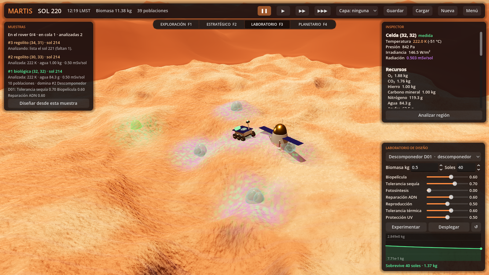

# ADR-030 — Muestras y análisis de laboratorio (V3)

- **Estado:** Propuesto, 2026-11-17. Los valores son GAME_BALANCE y están pendientes de ajuste jugando.
- **Contexto:** El bucle principal del Documento Maestro v2.0 (§4) es observar, recoger datos y muestras, formular hipótesis, diseñar y desplegar. El corte vertical (§32) pide un punto de muestreo, análisis y una estación de laboratorio. V3 sigue a V2 ([ADR-029](ADR-029-conocimiento-y-escaneo.md)), que añadió el conocimiento medido del terreno.

## Decisiones

### Tomar muestras (tecla M en Exploración)

- Solo se muestrea terreno **medido** con el escáner. No se muestrea a ciegas.
- El contenedor del rover lleva **4 muestras**. Cada muestra gasta un 2 % de batería tras el aterrizaje.
- Una muestra es una **copia congelada de la celda** (`CellReport`) en el sol en que se tomó. Es **biológica** si había poblaciones y de **regolito** si no.
- Cada toma es una orden del libro (`sample`, actor `rover`). Falla, con un aviso que explica por qué, si el terreno no está medido, el contenedor va lleno o falta batería.

### Entregar y analizar

- El rover entrega las muestras al acercarse a menos de 4 celdas del módulo. Antes del aterrizaje las analiza el laboratorio de a bordo, al momento.
- El laboratorio analiza **una muestra cada 2 soles**, en cola, al ritmo de la simulación. No se usa reloj real, así que el resultado es determinista.
- Cada análisis da puntos de investigación: 2 PI por regolito y 5 PI por muestra biológica. También deja una entrada en la bitácora.

### Diseñar desde una muestra

En el modo Laboratorio, el panel **Muestras** ocupa el sitio del de misión. Muestra lo que lleva el rover, lo que espera en cola y lo ya analizado. El análisis de una muestra incluye su temperatura, agua, dosis y, si es biológica, el genoma de la población dominante. El botón **«Diseñar desde esta muestra»** carga ese genoma en el laboratorio de diseño, dentro de los límites de edición investigados. Así se cierra el bucle «muestrear → analizar → diseñar → desplegar».

### Parámetros (`data/expedition/samples.v1.json`)

| Parámetro | Valor | Unidad |
| --- | --- | --- |
| `samples.capacity` | 4 | muestras |
| `samples.battery` | 0,02 | 1 |
| `samples.analysis_sols` | 2 | soles |
| `samples.delivery_radius` | 4 | casillas |
| `samples.research_regolith` | 2 | PI |
| `samples.research_biological` | 5 | PI |

## Consecuencias

- Nuevas acciones de tutorial: `collect-sample`, `deliver-sample`, `analyze-sample` y `design-from-sample`.
- Las muestras no cambian la simulación. Los puntos de investigación son de la campaña, como en H2.
- **Guardado.** Las muestras todavía no se guardan. V5 las guardará junto con el conocimiento.
- Por ahora no hay biofirmas nativas: toda la vida del valle la introduce el jugador. La protección planetaria (§28) llegará cuando exista vida nativa.
