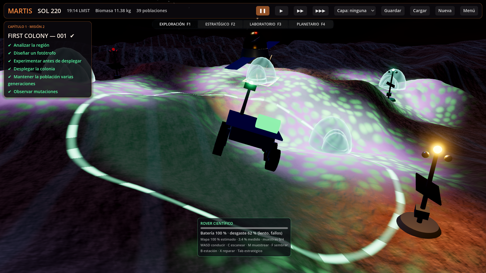

# ADR-031 — Robots e instalaciones: desgaste, estaciones y órdenes (V4)

- **Estado:** Propuesto, 2026-11-17. Los valores son GAME_BALANCE y están pendientes de ajuste jugando.
- **Contexto:** El Documento Maestro v2.0 dice que la IA actúa mediante robots con límites de energía, desgaste, terreno y comunicación (§6.2). También dice que la vista estratégica es una herramienta de planificación, no de omnipotencia: las órdenes pueden tardar, fallar o requerir intervención física (§7). V4 sigue a V3 ([ADR-030](ADR-030-muestras-y-laboratorio.md)).

## Decisiones

### Desgaste del rover

- El rover se desgasta un 0,2 % por casilla recorrida.
- Por encima del 50 % de desgaste pierde velocidad, hasta la mitad cuando está gastado del todo.
- También por encima del 50 %, los instrumentos (escáner y muestreo) pueden fallar, hasta un 60 % de probabilidad con desgaste total.
- El fallo se decide con un hash SplitMix64 de la semilla, el sol y el número de orden (`Faults.Happens`). No se usa `System.Random`, así que la repetición de una partida da el mismo resultado.
- Aparcado junto al módulo, el rover se repara un 2 % por segundo, además de cargarse.

### Estaciones fijas

- La tecla **B** en Exploración monta una estación de sensores sobre terreno medido. Cuesta un 15 % de batería.
- El módulo reparte 300 W y cada estación consume 100 W, así que caben 3.
- Cada sol, una estación activa mide un radio de 3 celdas (confianza 0,9) y se desgasta un 2 % por el polvo y los ciclos térmicos.
- A los 50 soles se avería y deja de medir. La bitácora lo avisa y el terreno parpadea en rojo.
- La tecla **X** repara la estación más cercana a menos de 2 casillas.
- La luz de cada estación muestra su estado: verde si funciona, ámbar si está desgastada y roja intermitente si está averiada.

### Órdenes al rover desde la vista estratégica

La tecla **G**, o el botón «Enviar el rover» del inspector, emite una orden `move` hacia la celda elegida. La orden queda **pendiente** mientras el piloto automático conduce el rover:

- Se **completa** al llegar.
- **Falla** si la batería se agota en ruta o si otra orden la sustituye.
- Los controles manuales tienen prioridad sobre el piloto automático, sin anular la orden.

Las demás órdenes del rover (escanear, muestrear, montar y reparar) también quedan en el libro, con su resultado o su motivo de fallo.

### Parámetros (`data/expedition/facilities.v1.json`)

| Parámetro | Valor | Unidad |
| --- | --- | --- |
| `facilities.power_budget` | 300 | W |
| `facilities.station_power` | 100 | W |
| `facilities.station_radius` | 3 | casillas |
| `facilities.station_confidence` | 0,9 | 1 |
| `facilities.station_wear` | 0,02 | 1/sol |
| `facilities.station_battery` | 0,15 | 1 |
| `facilities.rover_wear` | 0,002 | 1/casilla |
| `facilities.rover_repair` | 0,02 | 1/s |
| `facilities.fault_threshold` | 0,5 | 1 |
| `facilities.fault_max` | 0,6 | 1 |
| `facilities.repair_radius` | 2 | casillas |

## Consecuencias

- Nuevas acciones de tutorial: `send-rover`, `rover-arrived`, `build-station` y `repair-station`.
- Las estaciones y el desgaste no tocan la simulación biológica: solo alimentan el conocimiento (V2).
- **Guardado.** Las estaciones y el desgaste aún no se guardan. V5 los guardará con el conocimiento y las muestras.
- La energía es por ahora un presupuesto fijo del módulo. Los paneles, el polvo y las baterías como recursos llegarán con la fase E.
