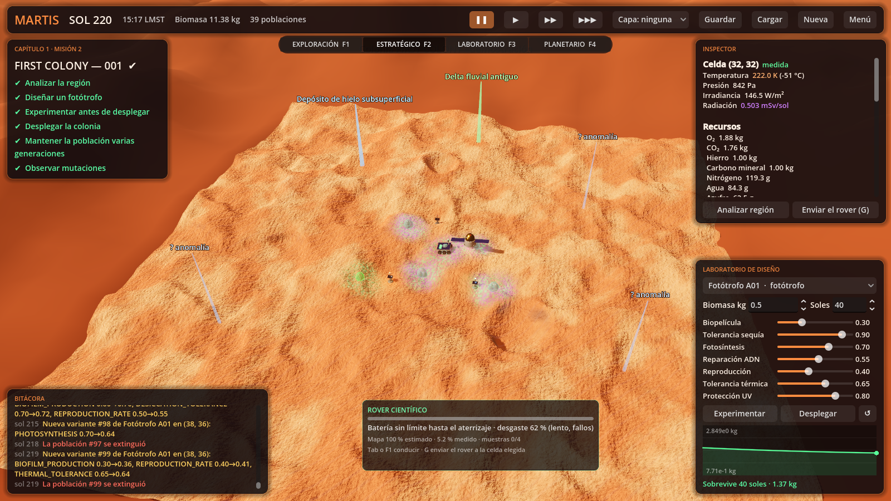

# ADR-032 — Valle Aurora, lugares de interés y guardado completo (V5)

- **Estado:** Propuesto, 2026-11-17. Los valores son GAME_BALANCE y están pendientes de ajuste jugando.
- **Contexto:** El primer corte vertical del Documento Maestro v2.0 (§32) pide un valle marciano ficticio pero parametrizado, con una región principal y zonas de interés, la misión FIRST COLONY y poder guardar, cargar y repetir el resultado con la misma semilla. V5 cierra el corte tras V1–V4 ([ADR-027](ADR-027-modos-sobre-un-estado.md), [ADR-029](ADR-029-conocimiento-y-escaneo.md), [ADR-030](ADR-030-muestras-y-laboratorio.md), [ADR-031](ADR-031-robots-e-instalaciones.md)).

## Decisiones

### Valle Aurora (`data/expedition/valley.v1.json`)

El valle tiene cinco lugares de interés. Cada uno se sitúa como fracción del mapa, así que existe en los mapas de 64, 128 y 256:

| Lugar | Tipo | Posición | PI |
| --- | --- | --- | --- |
| Delta fluvial antiguo | `Delta` | 0,50 · 0,14 | 8 |
| Depósito de hielo subsuperficial | `Ice` | 0,28 · 0,26 | 6 |
| Rastros de salmuera estacional | `Brine` | 0,74 · 0,34 | 5 |
| Abrigo rocoso del cañón | `Shelter` | 0,20 · 0,72 | 4 |
| Meteorito metálico | `Meteorite` | 0,80 · 0,70 | 4 |

El conocimiento de V2 decide el estado de cada lugar:

- **Oculto:** todavía no hay datos.
- **Anomalía:** la celda ya está estimada, por la sonda o por las cámaras. Aparece una baliza tenue con «? anomalía» y la bitácora sugiere enviar el rover.
- **Descubierto:** el escáner o una estación ha medido una celda a menos de 1,5 casillas. La baliza toma el color del tipo de lugar y muestra su nombre. La bitácora explica el hallazgo, que da puntos de investigación y la acción de tutorial `discover-poi`.

La vista planetaria cuenta los lugares descubiertos.

### Guardado completo

`ExpeditionState` guarda todo lo que no está en la instantánea de la simulación:

- el rover (posición, rumbo, batería, desgaste y módulo);
- la niebla de conocimiento, como confianzas de 16 bits en base64, redondeadas hacia arriba para que ninguna celda baje de nivel;
- las muestras, con la copia congelada de su celda y la cola del laboratorio;
- las estaciones, con su desgaste;
- el estado de cada lugar.

Se escribe como evento `expedition` en el mismo sol que la instantánea, junto al progreso de la misión. Al cargar se aplica sobre la expedición reconstruida. Una partida antigua, sin ese evento, sigue cargando como en V2: la sonda reconstruye el mapa.

Un mapa de 64×64 ocupa unos 12 KB por guardado.

## Consecuencias

- El corte vertical del §32 queda completo: exploración en tercera persona con escáner, muestreo y laboratorio, vista estratégica con capas y órdenes, FIRST COLONY y guardado y carga repetibles.
- El relieve aún no se moldea con los lugares: el delta o el cañón son marcas sobre el terreno procedural. Moldearlo, con `PlanetDefinition` (ARC-003), es el siguiente paso, junto con la fase E (terraformación regional).
- La guía de campaña (H8) puede usar `discover-poi` para una misión de reconocimiento.
