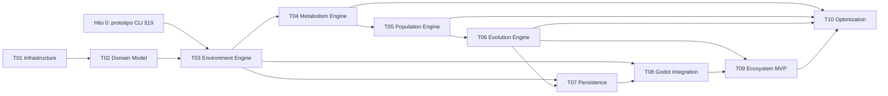

# ROADMAP técnico de MARTIS (T01–T10)

Fuente: TDD v1.0 §16 (hitos), §18–19 (primer sprint y prototipo), Anexo B.7 (estimación). Estado de todo el documento: **propuesta pendiente de visto bueno de Dani**. Huecos referenciados como H-nn están en [`TDD_HUECOS.md`](TDD_HUECOS.md); decisiones en [`ADR/`](ADR/README.md).

## Primer objetivo: prototipo CLI (TDD §19)

> **Hito 0 — Prototipo CLI.** Es el primer objetivo de todo el proyecto y se entrega dentro del Sprint 1 (`SPRINT_01.md`), antes de Godot. No necesita interfaz.

Definición de terminado (TDD §19), flujo completo:
**CLI → cargar escenario `MarsBaseline` → inicializar mundo 64×64 → inicializar ambiente → inicializar generador aleatorio determinista → ejecutar 1000 ticks → validar estado → crear snapshot → guardar resultados → salir con exit 0.**

Criterio verificable (propuesta de comando concreto, basado en TDD §11.1):

```bash
dotnet run --project src/Martis.Cli -- simulate \
  --scenario mars_baseline --seed 12345 --ticks 1000 \
  --output results/experiment_001
echo $?   # 0
```

- Existen `metadata.json`, `final_snapshot.json`, `resource_history.csv`, `simulation.log` (+ `population_history.csv` con cabecera) en la carpeta de salida (H-16: `mass_balance.csv` llegó con T04 y `mutations.csv` con T06).
- `tick == 1000` en el snapshot final; el validador no reporta violaciones.
- Dos ejecuciones con la misma semilla producen ficheros idénticos byte a byte (VAL-010; misma plataforma y runtime, §6).
- Un estado inválido inyectado en un test hace que el CLI termine con exit ≠ 0 y deje en el log semilla, tick, celda y sistema.

Este hito cubre completamente T01 y T02 y parcialmente T03 (sin población; ver abajo). No hay cifras de rendimiento comprometidas: los objetivos de TDD §7.4 son **objetivos**, no mediciones.

## Vista de dependencias



Notas: T07 técnicamente solo necesita un estado estable (puede empezar tras T03, y el Sprint 1 ya construye snapshots); el TDD lo ordena tras T06 y se mantiene ese orden como recomendación, con solapamiento permitido. T10 incluye benchmarks desde T03 (medir pronto), pero solo «cumple» tras T09. Estimación orientativa del GDD (Anexo B.7): 15–24 semanas, **no contractual**; no se asignan fechas aquí.

## Hitos

Convención: «Criterio TDD» es el literal de §16; «Criterio verificable» es la concreción propuesta (comando/test) que QA puede ejecutar.

### T01 — Infrastructure
- **Contenido (TDD):** Solución .NET, proyectos, referencias y build.
- **Incluye:** `MARTIS.sln`, `global.json`, `Directory.Build.props`, `Directory.Packages.props`, proyectos y tests según §1.2; README, `.gitignore`; CI mínima (propuesta, H-23); `Martis.Game` fuera de la solución por defecto hasta T08 (H-17).
- **Criterio TDD:** Todos compilan; tests automáticos.
- **Criterio verificable:** `dotnet build MARTIS.sln -c Release` y `dotnet test MARTIS.sln` con exit 0 desde un clon limpio; test de arquitectura verde (grafo de ADR-000 sin aristas prohibidas ni ciclos).
- **Depende de:** ADR-001/002 (SDK y TFM).
- **Avance:** Sprint 1, Día 1.

### T02 — Domain Model
- **Contenido (TDD):** Regiones, celdas, recursos, organismos, genomas y poblaciones.
- **Criterio TDD:** Crear y validar mundo 64×64.
- **Criterio verificable:** test que crea `SimulationState` 64×64 (4.096 celdas) y pasa el validador (VAL-001..005, con NaN/∞ rechazados); `Genome` rechaza expresiones fuera de [0,1]; `Population` no admite abundancia/biomasa negativas.
- **Depende de:** T01; H-02 (ubicación de `SimulationState`), H-13.
- **Avance:** Sprint 1, Día 2.

### T03 — Environment Engine
- **Contenido (TDD):** Temperatura, radiación, agua y nutrientes.
- **Criterio TDD:** 1.000 ticks sin estado inválido.
- **Criterio verificable:** test de integración que carga `mars_baseline`, avanza 1.000 ticks y el validador no reporta violaciones; mismas semilla/config ⇒ estado idéntico (VAL-010). Cada parámetro del escenario tiene clasificación y, si es `SCIENTIFIC_*`, fuente (ADR-000 R5).
- **Depende de:** T02, ADR-003 (PRNG); H-05 (unidad de Δt), H-07 y H-08 si hay difusión (ADR-008).
- **Nota:** el Sprint 1 entrega una versión mínima (ambiente sin población, sin difusión); la difusión, el agua accesible y los nutrientes completos se terminan aquí.

### T04 — Metabolism Engine
- **Contenido (TDD):** Reacciones, flujos, consumo y producción.
- **Criterio TDD:** Balances verificables.
- **Criterio verificable:** para cada reacción de `data/reactions/*.json`, test automático `A·S = 0` (VAL-007); tests de consumo ≤ disponibilidad (VAL-006) y energía consumida ≤ disponible (VAL-008); `mass_balance.csv` con error `ε_M ≤ ε_abs + ε_rel·|M|` por tick; asignación proporcional entre poblaciones sin ventaja por orden de iteración.
- **Depende de:** T02, T03; H-18 (unidades, composición elemental con fuente).
- **Estado:** implementado en `pipeline-v1` ([ADR-012](ADR/ADR-012-modelo-metabolico.md), propuesto): un fotótrofo (`phototroph_a01`), cuatro reacciones balanceadas, reparto proporcional y VAL-006/007/008 por tick.

### T05 — Population Engine
- **Contenido (TDD):** Crecimiento, mortalidad, capacidad y competencia.
- **Criterio TDD:** Dinámica coherente según condiciones.
- **Criterio verificable (propuesta):** pruebas por escenario con semilla fija: sin recursos ⇒ no hay crecimiento; recursos limitantes ⇒ crecimiento acotado por la capacidad `K = min(...)` sin crear recursos; mortalidad combinada `1 − Π(1 − mᵢ)` ∈ [0,1]; propiedad: abundancia y biomasa nunca negativas. «Coherente» se define con los casos esperados que acuerde MARTIS Ciencia (no con números inventados).
- **Depende de:** T04.
- **Estado:** implementado en `pipeline-v2` ([ADR-013](ADR/ADR-013-dinamica-de-poblaciones.md), propuesto): mortalidad combinada de seis términos, mantenimiento e inanición, capacidad `K = min(K_space, K_C, K_N, K_P)`, extinción con menos de un individuo y reciclaje de la necromasa.

### T06 — Evolution Engine
- **Contenido (TDD):** Mutación, herencia, selección y deriva.
- **Criterio TDD:** Variabilidad reproducible.
- **Criterio verificable:** misma semilla ⇒ mismas variantes y frecuencias (VAL-010); genes siempre en [0,1] (VAL-005); nunca más de `MaxVariantsPerSpeciesPerCell` variantes (ADR-006); fusión conserva abundancia y biomasa; `mutations.csv` generado.
- **Depende de:** T05; ADR-006, ADR-009.
- **Estado:** implementado en `pipeline-v3` ([ADR-014](ADR/ADR-014-evolucion.md), propuesto): mutación gaussiana acotada con el flujo Mutation, deriva multinomial con Nₑ (flujo GeneticDrift), fusión por tolerancia, tope de variantes y `mutations.csv`.

### T07 — Persistence
- **Contenido (TDD):** SQLite, snapshots, migraciones y recuperación.
- **Criterio TDD:** Guardar, cerrar, recuperar y continuar.
- **Criterio verificable:** test de integración: guardar, reabrir la base, cargar y continuar N ticks produce el mismo estado que ejecutar sin interrumpir (VAL-009 + VAL-010); corromper un byte del último snapshot ⇒ se recupera el anterior; migración inicial de §9.2 aplicada y versionada; H-14 (semilla ulong↔INTEGER) cubierta por test.
- **Depende de:** T02, T03 (estado estable), T06 recomendado; ADR-004.
- **Estado:** implementado ([ADR-015](ADR/ADR-015-guardado-sqlite.md), propuesto): formato binario `MRTS` v1 con SHA-256, esquema de estado v2, migraciones 1 (§9.2) y 2, `SaveGameStore`, recuperación del snapshot anterior y `simulate --save/--resume`.

### T08 — Godot Integration
- **Contenido (TDD):** Mapa, reloj, estadísticas y controles.
- **Criterio TDD:** Observar y controlar simulación.
- **Criterio verificable:** `Main.tscn` arranca con la versión fijada (ADR-001), muestra el mapa 64×64 como textura generada desde datos de celdas, reloj y estadísticas; pausa y cambio de velocidad funcionan (lista de comprobación manual con captura); Godot solo usa comandos/snapshots inmutables (el test de arquitectura prohíbe referencias a estado mutable); ninguna llamada a nodos desde el hilo de simulación.
- **Depende de:** T03, T07; decisión final de versión Godot/TFM (ADR-001/002, H-25).
- **Estado:** implementado en 3D ([ADR-017](ADR/ADR-017-juego-3d-godot.md), propuesto) a petición de Dani: relieve procedural, capas de datos 64×64 sobre el terreno, colonias bioluminiscentes, ciclo día/noche, misión, inspector, laboratorio, despliegue, guardado y carga. Godot 4.7.2 con `net10.0`.

### T09 — Ecosystem MVP
- **Contenido (TDD):** Tres arquetipos (fotótrofo, descomponedor, extremófilo), reciclaje y ecología.
- **Criterio TDD:** Completar FIRST COLONY.
- **Criterio verificable:** los tres arquetipos definidos en `data/organisms/` con parámetros clasificados; reciclaje de biomasa muerta conserva elementos (VAL-007); la misión FIRST COLONY (B.6: analizar región, diseñar fotótrofo, experimentar, desplegar, mantener varias generaciones, observar mutaciones) se completa en un escenario con semilla. **Umbrales de «mantener varias generaciones» pendientes de definir (H-19).**
- **Depende de:** T06, T08.
- **Estado:** motor implementado ([ADR-016](ADR/ADR-016-ecosistema-y-first-colony.md), propuesto): descomponedor D01 y extremófilo E01, ciclo de carbono y agua cerrado, diseño de genoma y misión FIRST COLONY completable con semilla en el CLI (`--mission first_colony`). La parte jugable va en T08. Umbrales H-19 propuestos.

### T10 — Optimization
- **Contenido (TDD):** Benchmarks y perfiles.
- **Criterio TDD:** Cumplir objetivos acordados.
- **Criterio verificable:** benchmarks BenchmarkDotNet (`EnvironmentUpdate`, `MetabolismUpdate`, `PopulationUpdate`, `MutationUpdate`, `SnapshotCreation/Restore`, `FullSimulation`) con hardware, runtime, tiempo medio, memoria y GC documentados; comparación con §7.4 (4.096 celdas, 10.000 poblaciones, 3 organismos, ≤ 32 variantes, 1.000 ticks < 10 s, snapshot < 1 s, memoria < 256 MB) **en equipo de referencia documentado (H-20)**. Los objetivos pueden ajustarse con mediciones; ninguna cifra se da por conseguida sin reporte.
- **Depende de:** T04–T06 y T09 para el cierre; los benchmarks parciales empiezan en el Sprint 1.

## Fuera de alcance del MVP (TDD §0, B.5)

Dinámica molecular, individuos celulares como entidades, atmósfera 3D, meteorología global, fluidos avanzados, GPU compute, multijugador, servidores distribuidos, IA generativa, terraformación global físicamente completa, ECS complejo, multithreading masivo (ADR-007).
